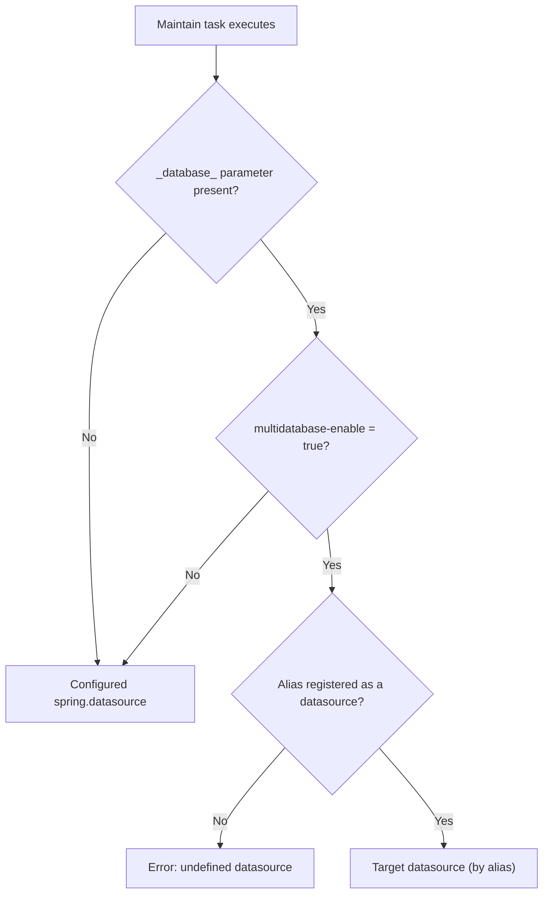

import Tabs from '@theme/Tabs';
import TabItem from '@theme/TabItem';

This document gives a minimum base to start with the AWE Scheduler module, and explains how to automate and schedule tasks inside AWE in a simple way.

The Scheduler module is based on the Quartz Scheduler library. 

All documentation related to the Quartz Scheduler library can be found on its [web page](https://quartz-scheduler.org/documentation).

## Prerequisites

The scheduler module needs to be configure before it is used. 

To see how to configure the scheduler module for your application see the **[Configuration guide](../scheduler-module.md)**.

## Remote scheduler setup

You can split the scheduler into a dedicated AWE instance and have your main AWE application delegate scheduling to it.

### 1. Configure the scheduler instance

On the dedicated scheduler node, enable scheduler-only mode and configure the callback to your main AWE app:

```properties
# Scheduler-only instance
awe.scheduler.scheduler-instance=true

# Callback to the main AWE instance
awe.scheduler.remote-callback-url=http://localhost:8080
awe.scheduler.remote-callback-secure-enabled=true
awe.scheduler.remote-callback-user=scheduler
awe.scheduler.remote-callback-password=ENC(yourEncryptedPassword)
```

### 2. Configure the main AWE instance

On the main AWE app, enable remote scheduler usage and point to the scheduler base API URL:

```properties
awe.scheduler.remote-enabled=true
awe.scheduler.remote-scheduler-url=http://localhost:8090/scheduler/api/v1
```

> **Note:** The remote scheduler base URL must target the scheduler instance API (default: `/scheduler/api/v1`).

:::warning Breaking change: the scheduler API now requires authentication
The scheduler instance now answers `/scheduler/api/**` only to requests with an AWE bearer token, and the scheduler instance needs the [AWE REST starter](../rest-module.md) to validate it. The main AWE instance must therefore log in with a user of the scheduler instance, configured in `awe.scheduler.remote-scheduler-user` and `awe.scheduler.remote-scheduler-password`. See [Scheduler API security](../scheduler-module.md#scheduler-api-security).
:::


* **[Tasks](#tasks)**
* **[Servers](#servers)**
* **[Calendars](#calendars)**

| To | Open | Screen |
|----|------|--------|
| See what runs, waits or failed | **Activity** | `scheduler-activity` |
| Create, edit, run or delete a task | **Tasks**, then the task | `scheduler-task-catalog`, `scheduler-task` and `scheduler-task-editor` |
| Follow one flow run | A flow run link of Activity or of the task | `scheduler-flow-run` |
| Manage servers, calendars or the engine | **Configuration** | `scheduler-configuration` |
    

## `Tasks`

A task consists on a job associated to a trigger that is executed by the Scheduler in the configured time / moment.

A task can also be concatenated with other tasks to create a workflow. This is done in each task that runs later: **When** › **After other tasks** of the [task editor](#configuration) chooses the tasks it runs after (see [Dependencies between tasks](dependencies-guide.md)).

### Types

There are two type of tasks that the scheduler can work with, the maintain tasks and the command tasks.

| Maintain Task                                                        | Command Task                                                                                                          |
|----------------------------------------------------------------------|:---------------------------------------------------------------------------------------------------------------------|
| A maintain task executes a public maintain with a defined schedule.  | A command task runs a shell command with a defined schedule, either on the local AWE host or on a remote host over SSH. |

### Command execution: local and remote

A command task runs the value entered in the **Command** field as a shell command. The **Execution path**, when set, is used as the *working directory* the command runs in, and it also acts as a fallback location for the command itself: the command is looked up on the host `PATH` first, and only when the `PATH` does not provide it is an executable file of that name inside the execution path used. A script living in the execution path therefore runs by its bare name, while a system command such as `ls` or `python` always keeps resolving from the `PATH` and is never shadowed by a file of the same name in the execution path. A command already containing a path separator (`./my-script.sh`, or an absolute path) is used exactly as written.

- **Local execution** (default): when **Run on remote server** is left unchecked, the command runs on the AWE host itself.
- **Remote execution over SSH**: when **Run on remote server** is checked, a **Remote server** must be selected. The command is executed on that host through an SSH exec channel, and both its standard output and standard error are captured into the task execution log.

Remote command execution requires the selected server to use the `ssh` connection type. Authentication is done with the server user together with either a password, a private key (optionally passphrase-protected), or both. See **[Servers](#servers)** for how to configure them, and the **[Configuration guide](../scheduler-module.md#ssh-remote-command-execution)** for the SSH host-key verification options.

### Deferred executions

A maintain task can finish later. This is for work that another system completes after the maintain returns, and that you do not want to hold a scheduler thread for. The maintain answers that it accepted the work, the execution stays **running** without holding any thread, and the other system (or your own code) completes the execution when the work ends.

1. The scheduler launches the maintain, which starts the work in the other system and answers **deferred**.
2. The scheduler releases its thread. The execution stays **running** and its dependencies are not launched.
3. When the work ends, whoever finished it completes the execution with its final status (see [Completing the execution](#completing-the-execution)).
4. The task dependencies are launched with the usual rules (`Launch dependencies in case of warning` / `in case of error`).

#### The deferred answer

A maintain answers deferred when its last step is a service that returns `SchedulerDeferred.accepted(externalReference, description)`:

```java
public ServiceData startExternalWork(Integer taskId, Integer executionId) {
  // Start the work and hand the execution key to the system that will complete it
  String reference = externalSystem.start(taskId, executionId);
  return SchedulerDeferred.accepted(reference, "Waiting for the external system");
}
```

```xml
<!-- Services.xml -->
<service id="startExternalWork">
  <java classname="com.example.ExternalWorkService" method="startExternalWork">
    <service-parameter name="taskId" type="INTEGER"/>
    <service-parameter name="executionId" type="INTEGER"/>
  </java>
</service>

<!-- Maintain.xml -->
<target name="startExternalWork">
  <serve service="startExternalWork">
    <variable id="taskId" type="INTEGER" name="taskId"/>
    <variable id="executionId" type="INTEGER" name="executionId"/>
  </serve>
</target>
```

Then create a maintain task that executes the `startExternalWork` maintain.

- The deferred answer must be the answer of the **last step** of the maintain.
- It works the same when the scheduler runs as an [external application](#remote-scheduler-setup): the answer travels back to the scheduler instance with the answer of the maintain call.
- `externalReference` is an optional reference of the work in the other system, stored with the execution. It is cut to 256 characters.
- `description` is optional. It is shown as the description of the execution while it waits, and it is cut to 2000 characters.

#### The execution key

The scheduler gives every maintain two reserved parameters: `taskId` and `executionId`. Declare variables with those names in the maintain target, as in the example above, to receive them. They identify the execution, so the maintain must hand them to whoever will complete it. They take priority over a task parameter with the same name.

#### While the execution waits

- The execution is stored as **running** with the description of the deferred answer.
- The task dependencies are not launched and the execution is shown as **Waiting for confirmation** in the [Activity screen](#activity-screen).
- No scheduler thread is held.

#### Completing the execution

The system that finishes the work calls the scheduler API (on the scheduler instance when you use a [remote scheduler](#remote-scheduler-setup)):

```text
POST /scheduler/api/v1/tasks/{taskId}/executions/{executionId}/complete
```

The request needs an AWE bearer token, like the rest of `/scheduler/api/**` (see [Scheduler API security](../scheduler-module.md#scheduler-api-security)). The body is a JSON object:

| Field         | Description                                                                                    |       Required       |
|---------------|:-----------------------------------------------------------------------------------------------|:--------------------:|
| `status`      | Final status: `OK`, `WARNING`, `ERROR`, `STOPPED`, `INTERRUPTED` or `INFO` (case insensitive)  |     **Required**     |
| `description` | Description of the execution, 2000 characters at most                                          |       Optional       |
| `outputs`     | Object with text values for the dependencies (see [Outputs](#outputs))                         |       Optional       |

```bash
curl -X POST "https://scheduler.example.com/scheduler/api/v1/tasks/12/executions/340/complete" \
  -H "Authorization: Bearer $TOKEN" -H "Content-Type: application/json" \
  -d '{"status": "OK", "description": "Calculation finished"}'
```

| Response | Meaning                                                                                                              |
|:--------:|:---------------------------------------------------------------------------------------------------------------------|
|   200    | The execution was completed. The body is `{"taskId": 12, "executionId": 340, "status": "JOB_OK"}`                    |
|   400    | The `status` is missing or is not one of the allowed values, or the `description` is longer than 2000 characters      |
|   401    | The request has no valid bearer token                                                                                |
|   404    | The execution does not exist                                                                                         |
|   409    | The execution cannot be completed. The body is `{"type": "...", "currentStatus": "JOB_OK"}`, with one of the types below |

| 409 `type`               | Meaning                                                                                                           |
|--------------------------|:------------------------------------------------------------------------------------------------------------------|
| `execution-not-running`  | The execution was already completed, interrupted by its deadline or stopped. `currentStatus` is the status it has |
| `execution-not-deferred` | The execution is not registered as deferred, so it cannot be completed from outside. With `currentStatus` `JOB_RUNNING` the maintain may not have answered yet: retry shortly if you expect it to be deferred |

A `409` with `execution-not-running` is final: the execution is already closed and repeating the call will not change it, so do not retry it.

The status decides what happens to the dependencies, with the usual rules: they are launched after `OK`, after `WARNING` only with `Launch dependencies in case of warning`, after `ERROR` only with `Launch dependencies in case of error`, and never after `STOPPED`, `INTERRUPTED` or `INFO`. The scheduler closes the execution once, writes its end, sends the task report and launches the dependencies; any other completion of the same execution does nothing.

Code that runs in the same application as the scheduler can complete the execution without the API, with the `SchedulerExecutionCompletionService` bean:

```java
CompletionResult result = completionService.complete(taskId, executionId, TaskStatus.JOB_OK,
  "Calculation finished", null);
// result.outcome(): CLOSED, NOT_RUNNING, NOT_DEFERRED or UNKNOWN
```

#### Outputs

The `outputs` of the completion reach the dependencies launched when the execution closes, as the other values of the parent task do: each dependency takes the value of every output whose name matches one of its **variable** parameters. An output replaces a parameter of the closed task with the same name, and an output without a name or a value is ignored.

```bash
curl -X POST "https://scheduler.example.com/scheduler/api/v1/tasks/12/executions/340/complete" \
  -H "Authorization: Bearer $TOKEN" -H "Content-Type: application/json" \
  -d '{"status": "OK", "outputs": {"resultFile": "/data/out/340.csv"}}'
```

A dependency with a variable parameter `resultFile` runs with `/data/out/340.csv`.

#### Deadline, stop and restart

- **Deadline**: an execution that is not completed within the task **Timeout**, or within `awe.scheduler.deferred.default-timeout` (24 hours by default) when the task has none, counted from the start of the execution, ends as **interrupted** with the timeout message and its dependencies are not launched. The scheduler checks the deadlines every `awe.scheduler.deferred.timeout-check-interval` (60 seconds by default), so the execution can end after its deadline by up to that interval. A completion that arrives later gets a `409`. See the **[Configuration guide](../scheduler-module.md#deferred-executions)**.
- **Stop**: the stop action of the execution side panel (Activity, the history of the task and the flow run page) ends the waiting execution as **stopped**, without launching dependencies.
- **Restart and cluster**: the state of a waiting execution is stored in the database, so it survives a restart. At startup the scheduler interrupts the executions that a stopped node left running, except the ones that are waiting to be completed. Every node checks the deadlines and any node can receive the completion, but only the first call that closes an execution ends it.

#### Cancellation notice

When a user stops a deferred execution or its deadline passes, the other system may still be working on it. Fill **Cancellation maintain** in the task (maintain tasks only) to tell it: the call that closes the execution launches that maintain once, where the task maintain runs (on the AWE application for an [external scheduler](#remote-scheduler-setup)), with these parameters:

| Parameter           | Value                                              |
|---------------------|:---------------------------------------------------|
| `taskId`            | Task identifier                                    |
| `executionId`       | Execution identifier                               |
| `externalReference` | The `externalReference` of the deferred answer     |

A completion through the API or the `SchedulerExecutionCompletionService` does not send it: the other system closed the execution itself. The notice never reopens or blocks the execution: when the maintain fails or answers an error, the execution stays closed and the failure is stored in its trace.

#### Trace and counters

Every deferred execution keeps, after it closes, who closed it and when (`API`, `DEADLINE` or `USER`) and the outcome of its cancellation notice (`SENT`, or `FAILED` with the error message). The side panel of the execution in the [Activity screen](#activity-screen) shows what a waiting execution waits for and its deadline, its **Waiting for confirmation** counter counts the executions that wait, and the **Engine** tab of the Configuration screen links to them.

### Task execution database

A **maintain task** runs against the datasource configured through Spring Boot's `spring.datasource.*` properties. This is the case in **both** execution modes:

- **Local (embedded) scheduler** &mdash; the maintain runs on the same datasource as the main AWE application.
- **Remote scheduler instance** &mdash; the maintain runs on the datasource configured for *that* scheduler instance.

:::info Why always the configured datasource?
Scheduler tasks run on a Quartz worker thread with **no bound HTTP session**. The interactive multi-database routing that a normal web request relies on reads its target from session/screen state, which simply does not exist here. The scheduler therefore resolves the connection from the configured `spring.datasource` instead of any session value.
:::

:::tip A remote scheduler's database is a deployment decision
There is no per-task switch to "run this task on the main application's database". A remote scheduler instance uses **its own** `spring.datasource`. To make it target the same database as your main application, point that instance's `spring.datasource.url` (and user, password, &hellip;) at the same database.
:::

#### Targeting a different database

If a specific maintain task must run against a **different** database than the configured default, add a **task parameter** (see [Task parameters](#2-task-parameters)) whose **name is the database criterion** and whose **value is the target datasource alias**.

The parameter name is **not** hardcoded to `database`: it is the value of [`awe.database.parameter-name`](../properties.md#awe.database.parameter-name), which defaults to `_database_`.

<Tabs>
<TabItem value="single" label="Single-database (default)" default>

Nothing to configure. With [`awe.database.multidatabase-enable`](../properties.md#awe.database.multidatabase-enable) set to `false` (the default), every task runs against the single configured `spring.datasource`, and a parameter named `_database_` is treated as an ordinary parameter with **no** routing effect.

</TabItem>
<TabItem value="multi" label="Multi-database">

On a deployment with `awe.database.multidatabase-enable=true`, add a task parameter in the **Parameters** section of the task editor:

| Field  | Value                                                        |
|--------|-------------------------------------------------------------|
| Name   | `_database_` (or your configured `awe.database.parameter-name`) |
| Source | `Value`                                                      |
| Value  | The **alias** of the target datasource (e.g. `reporting`)   |

When the task executes, its maintain is routed to the datasource registered under that alias instead of the default one.

</TabItem>
</Tabs>

The connection is resolved as follows:



:::warning Requirements for routing to another database
- [`awe.database.multidatabase-enable`](../properties.md#awe.database.multidatabase-enable) must be `true`. When it is `false`, the parameter is ignored and the task always uses the default datasource.
- The **value must be a registered datasource alias**, not a raw JDBC URL. An unknown alias raises an *undefined datasource* error at execution time.
:::

:::note Command tasks are not affected
This applies to **maintain** tasks only. A **command** task runs a shell command and has no database connection; see [Command execution: local and remote](#command-execution-local-and-remote).
:::

### Configuration

Tasks are created and changed in the **task editor** (`scheduler-task-editor`): **New task** in the **Tasks** catalog,
**Edit** or **Duplicate** in the row menu of the catalog or in the task page. The editor is one page with six
sections, each one described below; the navigation on the left marks the section in sight and the ones with errors, the
summary on the right follows the changes, and **Save** opens the task page of the saved task. See the
[task editor](../scheduler-module.md#task-editor) for its targets.

| Section | Content | Below |
|---------|---------|-------|
| What it runs | Name, description and execution type with its fields | [1](#1-basic-information) |
| Parameters | The parameters of the task | [2](#2-task-parameters) |
| When | Manual, scheduled, when a file arrives, after other tasks or webhook | [3](#3-task-launch) |
| Dependencies | The tasks that run after it, read only | [4](#4-task-dependencies) |
| Behaviour | Timeout, executions kept, active and the three dependency switches | [1](#1-basic-information) |
| Notifications | The report of the task | [5](#5-task-report) |

#### 1. What it runs and Behaviour {#1-basic-information}

The fields of **What it runs** and **Behaviour**.

| Element                                   | Definition                                                                                                                                       |                         Use                          |
|-------------------------------------------|:-------------------------------------------------------------------------------------------------------------------------------------------------|:----------------------------------------------------:|
| Name                                      | Task name                                                                                                                                        |                     **Required**                     |
| Active                                    | Task status, if not active the task would not be launched                                                                                        |                     **Required**                     |
| Description                               | Task description                                                                                                                                 |                       Optional                       |
| Executions kept                           | Maximum number of executions to be stored in the database (Used to calculate the average time). The default value is 10.                         |                       Optional                       |
| Timeout                                   | Maximum time for the task to finish. If the task execution time exceeds the timeout time (represented in seconds) the task will be interrupted   |                       Optional                       |
| Execute                                   | The task execution type (Command or Maintain)                                                                                                    |                     **Required**                     |
| Command                                   | Command to launch                                                                                                                                | **Required** (Only needed in `Command` launch type)  |
| Execution path                            | Working directory the command runs in, and fallback location for the command: the host `PATH` is searched first, this path second               |   Optional (Only needed in `Command` launch type)    |
| Run on remote server                      | When checked, the command runs on a remote host over SSH instead of on the local AWE host                                                        |   Optional (Only needed in `Command` launch type)    |
| Remote server                             | The SSH server on which the command is executed                                                                                                  | **Required** when `Run on remote server` is checked  |
| Maintain                                  | Maintain to launch                                                                                                                               | **Required** (Only needed in `Maintain` launch type) |
| Launch dependencies in case of warning    | Launch the task dependencies in case of warning                                                                                                  |                       Optional                       |
| Launch dependencies in case of error      | Launch the task dependencies in case of error                                                                                                    |                       Optional                       |
| Set execution as warning in case of error | Sets the parent execution as warning in case of dependency error                                                                                 |                       Optional                       |

> **Note:** To add a new maintain to the Scheduler, the maintain must be set to `public="true"`.

#### 2. Parameters {#2-task-parameters}

This section allows to add the needed parameters to the maintain or command for its execution.

These parameters are loaded to the application context when the task is going to be executed. In this way, the task can get the parameters in the execution time.

| Element       | Definition                                                                                                                                                     |     Use      |
|---------------|:---------------------------------------------------------------------------------------------------------------------------------------------------------------|:------------:|
| Name          | Parameter name                                                                                                                                                 | **Required** |
| Source        | Parameter source, the place from which the parameter will take its value                                                                                       | **Required** |
| Type          | The parameter type (Only used to give extra information to the user)                                                                                           | **Required** |
| Value         | For `Value`, the literal value used. For `Property`, the key of the application property to resolve. For `Variable`, the default value pre-filled in the manual-launch dialog (may be left empty) |   Optional   |


> **Note:** If the task launch type is `Maintain`, the needed parameters for the selected maintain will be automatically added to the task parameters screen.

##### Parameter sources #####

The **Source** determines where each parameter takes its value from at execution time:

- **Value** &mdash; the parameter uses the literal value typed in the **Value** field.
- **Property** &mdash; the value is resolved at execution time from the application property whose key is in the **Value** field (for example a value configured in `application.yml`). Use it to keep environment-specific values out of the task definition.
- **Variable** &mdash; the value is supplied by the operator **when the task is launched manually**. This is for inputs that are only known at run time (a business date, an entity id, a run mode&hellip;) and should not be hardcoded in the task.

When a task has one or more `Variable` parameters, launching it with **Run…** (the Tasks catalog or the task page) opens the [run dialog](../scheduler-module.md#run-dialog) with an editable grid listing exactly those parameters. Each row is pre-filled with its configured **Value** as an editable default; the operator reviews or changes the values and presses **Run**, and the task runs with them. Tasks without parameters launch directly with **Run now**, with no dialog.

> **Note:** The dialog only appears on **manual** launch, where an operator is present to fill it in. On **scheduled** and **file** launches there is nobody to prompt, so a `Variable` parameter falls back to its configured **Value**. On **dependency** launch the value is inherited from the parent task &mdash; see [Parameter propagation to dependencies](#parameter-propagation-to-dependencies).

#### 3. When {#3-task-launch}

The **When** section chooses how the task is launched, as choice cards: manual, scheduled, when a file arrives, after other tasks or webhook.

##### 1. Manual ####

The task will only be launched by hand: **Run…** or **Run now** in the Tasks catalog or in the task page.

> **Note:** **After other tasks** is stored as a `Manual` launch with parents (see [4. Dependencies](#4-task-dependencies)).

##### 2. Scheduled ####

The task will be launched with a cron pattern based schedule. The editor offers repetition presets (every N minutes or hours, daily, workdays, weekly, monthly, once) and *Custom*, with a preview of the next five runs (see the [task editor](../scheduler-module.md#task-editor)).

See [schedule configuration guide](schedule-configuration) for more information about how to create schedules for a task.

##### 3. File ####

With this launch type, the task will launch a check in the selected file/s with the configured schedule.

To know how to create a schedule for the task see [schedule configuration guide](schedule-configuration).

The remaining fields are:

| Element      | Definition                                                   |     Use      |
|--------------|:-------------------------------------------------------------|:------------:|
| Search at    | The server in which the scheduler has to check for the files | **Required** |
| File path    | The path in which the file/s are located                     | **Required** |
| File pattern | The pattern that the files have to match with                | **Required** |

The server's connection type decides how the check is performed: `folder` reads a local or shared
folder, `ftp` connects over FTP, and `ssh` connects over SFTP.

> **Note:** The connection credentials are not configured here. Both `ftp` and `ssh` servers
> authenticate with the credentials stored on the [server](#servers) itself, the same ones used for
> remote command execution, so every task pointing at the same server shares them.

##### 4. Webhook ####

The task is launched when another system sends a signed webhook to it. A webhook task has no schedule of its own: each valid webhook launches it once, immediately, as a manual launch does.

The hook of the task is defined with these fields:

| Element         | Definition                                                                                                                                             |     Use      |
|-----------------|:-------------------------------------------------------------------------------------------------------------------------------------------------------|:------------:|
| Hook key        | Last part of the URL. Lowercase letters, digits and hyphens, 1 to 64 characters. Another task cannot use it: a repeated key is rejected when saving | **Required** |
| Hook active     | A hook that is not active is answered with `409` and launches nothing                                                                                  | **Required** |
| Secret property | Name of the application property that holds the signing secret. The secret itself is never stored or shown                                             | **Required** |
| Event type      | Only webhooks of this `type` launch the task, the others are stored and ignored. Empty accepts any type                                                |   Optional   |

The form shows the **Webhook URL** of the key, ready to copy into the sender:

```text
https://<host>/<context-path>/scheduler/api/v1/webhooks/triggers/<hookKey>
```

###### The request ######

The request follows [Standard Webhooks](https://www.standardwebhooks.com/): a `POST` with a JSON body and the headers `webhook-id` (unique id of the message), `webhook-timestamp` (Unix seconds) and `webhook-signature`.

```json
{
  "type": "fit.market-data.loaded",
  "timestamp": "2026-11-13T06:00:02Z",
  "data": { "date": "2026-11-12", "entity": "0049" }
}
```

The body must be a JSON object with a `data` object and an optional `type`. The signature is `v1,` followed by the base64 of the HMAC-SHA256 of `{webhook-id}.{webhook-timestamp}.{body}` (the exact bytes of the body), keyed with the secret without its `whsec_` prefix, decoded from base64:

```python
import base64, hashlib, hmac
key = base64.b64decode("whsec_AAECAwQFBgcICQoLDA0ODxAREhMUFRYXGBkaGxwdHh8=".removeprefix("whsec_"))
signed = f"{msg_id}.{timestamp}.{body}".encode()
signature = "v1," + base64.b64encode(hmac.new(key, signed, hashlib.sha256).digest()).decode()
```

To test a sender, this vector gives the expected signature (with the timestamp check disabled or the clock fixed):

| Data | Value |
|------|-------|
| Secret | `whsec_AAECAwQFBgcICQoLDA0ODxAREhMUFRYXGBkaGxwdHh8=` |
| `webhook-id` | `0193f2a4-6c1e-7b3a-9d2e-5f8a1c4e7b20` |
| `webhook-timestamp` | `1763029530` |
| Body | `{"type":"job.finished","timestamp":"2025-11-13T10:25:30Z","data":{"jobId":"0193f2a0-1111-7aaa-8bbb-000000000001","status":"COMPLETED"}}` |
| `webhook-signature` | `v1,A4hcS6QMtMJGUshESWRCI0SK2l7hfSW/LXYbcYD8Ef0=` |

###### The responses ######

| Response | When |
|----------|------|
| `202 {"messageId": "<webhook-id>"}` | Accepted, also when the `webhook-id` was already received. The task is launched later, outside the request |
| `400` | The body is not a JSON object with a `data` object |
| `401` | The signature or the timestamp are not valid, or the secret property has no value |
| `404` | Unknown hook key |
| `409` | The hook or its task are not active |
| `413` | The body is bigger than `awe.scheduler.webhooks.max-body-size` |

**Deduplication.** A webhook is identified by its hook key and its `webhook-id`. A webhook that was already received is answered with `202` again and does not launch the task a second time, so a sender can retry safely.

**Processing.** The webhook is stored in an inbox and answered at once. A processor launches the task from the inbox every `awe.scheduler.webhooks.process-interval`. If the launch fails it is tried again after a growing wait, up to 3 attempts in total, and then the webhook stays failed with its error. Processed, ignored and failed webhooks are purged after `awe.scheduler.webhooks.inbox-retention`. The execution shows `webhook:<hookKey>` as who launched it. If the task is already running, the webhook launches another execution, as a manual launch does. While the scheduler is stopped the webhooks wait in the inbox, and they are launched when it starts again.

###### Parameter pointers ######

The **Parameters** section of a webhook task has a **JSON pointer** column. A pointer (for example `/date`) says which value of the `data` of the webhook goes into the parameter:

- Only `VARIABLE` parameters with a pointer receive webhook values: the pointers are an allow list, and nothing else of the webhook reaches the task.
- A pointer that is not in the webhook leaves the stored value of the parameter.
- The mapped values become the **parameters of the run**, so they reach every step of the flow that the task starts (see [Flow runs and fan-in](dependencies-guide.md#flow-runs-and-fan-in)).

The properties, the secret rotation and the migration are in the **[Configuration guide](../scheduler-module.md#webhook-launch)**.

#### 4. Dependencies {#4-task-dependencies}

The dependencies are chosen **in the task that runs later**: **When** › **After other tasks** lists the tasks it can run
after, grouped in *Chosen*, *Available* and *Cannot be chosen* (the tasks that already run after it, which would close a
loop). With several parents the task waits for all of them. The condition of each parent (launch its children on
warning, on error) is set in the **Behaviour** of the parent and shown read only.

The **Dependencies** section lists, read only, the tasks that run after the task, each one a link to its task page.
See **[Dependencies between tasks](dependencies-guide.md)** for flow runs and fan-in.

> **Note:** The dependencies can also have their own dependencies to create a workflow.

##### Parameter propagation to dependencies

When a task launches its dependent (child) tasks, the parent's parameter values at execution time are propagated to each child. The **child defines the contract**: only the child's `Variable` parameters whose **name matches** a parent parameter are overridden with the parent's value. Every other parent parameter is ignored by that child, and the child's non-`Variable` parameters are never touched.

- **What propagates** &mdash; the parent's value for a given name, regardless of the parent parameter's source (`Value`, `Property` or `Variable`). Where the parent obtained the value is irrelevant; only the name matters.
- **Default when absent** &mdash; if the parent does not supply a matching name, the child keeps its own configured **Value** as the default (no regression versus previous behavior).
- **Cascade** &mdash; at each hop the propagation map is rebuilt from the current task's own parameter list, so a value only continues past an intermediate task if that task **also declares a parameter with that name**. A value the parent supplies for a name an intermediate child does not declare stops at that child and is not passed on to the grandchild.

Example, with a parent task that holds `database = "prod"` (source `Value`):

| Child parameter declaration | Effective value in the child | Why |
|---|---|---|
| `database` as `Variable` | `"prod"` | Name matches a parent parameter and the child opted in via `Variable` |
| `database` as `Value` = `"test"` | `"test"` | Not a `Variable`; never overridden |
| `region` as `Variable` (parent has no `region`) | its configured default | Parent supplies no matching name |

This reuses the same mechanism as the operator-supplied values on manual launch, so a value an operator typed into the parent's launch dialog also flows down to its dependents.

:::warning Trust boundary for sensitive values
Propagation is name-based: any dependent task that declares a `Variable` parameter matching a parent parameter name receives the parent's value at execution time &mdash; including values that may be sensitive (credentials, connection strings). Task configuration is an administrator-trusted boundary; do not attach dependencies of untrusted provenance to tasks holding sensitive parameters.
:::

#### 5. Notifications {#5-task-report}

The **Notifications** section chooses a report type.

The report will give information about the task when it finishes.

We can choose one of these four options: 

##### 5.1 None ####

Used when we don't want to retrieve any report from the task.

This could be compared to the silent-action in AWE.

##### 5.2 Email ####

This option will send an email with the task information, and it will also add the dependencies information if any.

| Element           | Definition                                                                  |     Use      |
|-------------------|:----------------------------------------------------------------------------|:------------:|
| Send in case of   | Set the allowed status (task status when it finishes) for sending the email | **Required** |
| Email server      | The email server form where the email is going to be sent                   | **Required** |
| Send to users     | The list of users to send the email                                         | **Required** |
| Title             | The title of the email                                                      | **Required** |
| Message           | The message to be added in the email                                        | **Required** |

> **Note:** The email will also add basic information about the task itself and its dependencies.

###### Dynamic variables in Title and Message

The **Title** and **Message** fields support `${variable}` placeholders that are resolved with per-execution values before the email is sent. This lets a single template produce a customized email for every task execution.

Placeholders can reference two kinds of values: **task/execution metadata** (reserved names) and **task parameters** (by name).

**Metadata variables**

| Variable             | Description                                             |
|----------------------|--------------------------------------------------------|
| `${taskName}`        | Name of the task                                       |
| `${taskId}`          | Task identifier                                        |
| `${taskDescription}` | Task description                                       |
| `${status}`          | Final execution status label (e.g. `OK`, `ERROR`)      |
| `${statusDetail}`    | Additional detail about the execution status           |
| `${executionId}`     | Execution identifier                                   |
| `${command}`         | Command/action executed by the task                    |

**Task parameter variables**

Any placeholder whose name matches a task parameter (from the **Parameters** section of the task) is replaced with that parameter's value. For example, `${env}` resolves to the value of the `env` parameter.

**Resolution rules**

- **Reserved names take precedence.** If a task parameter has the same name as a metadata variable (e.g. `status`), the metadata value wins and a warning is logged naming the shadowed parameter.
- **Unknown placeholders are kept literally.** A `${variable}` with no matching metadata key or task parameter is left untouched in the output; it is never blanked or removed.
- **HTML is escaped safely.** In the HTML body, substituted values are HTML-escaped so they cannot break the markup or inject content; the plain-text body receives the raw values. The template text itself is never escaped.
- **Backward compatible.** A Title or Message without any `${...}` placeholder is sent exactly as written.

**Example**

- Title: `Task ${taskName} finished: ${status}`
- Message: `Execution ${executionId} for environment ${env} ended with status ${status}.`

> **Note:** Variable substitution applies only to the **Title** and **Message** fields, not to the fixed task-details block that the report appends automatically.

##### 5.3 Broadcast ####

This option will send a broadcast message with the given message to the selected users only.

| Element          | Definition                                                                      |     Use      |
|------------------|:--------------------------------------------------------------------------------|:------------:|
| Send in case of  | Set the allowed status (task status when it finishes) for sending the broadcast | **Required** |
| Send to users    | The list of users to send the broadcast                                         | **Required** |
| Message          | The message to be sent in the broadcast                                         | **Required** |

##### 5.4 Maintain ####

This option will launch the selected maintain as a report.

| Element          | Definition                                                                                                 |     Use      |
|------------------|:-----------------------------------------------------------------------------------------------------------|:------------:|
| Send in case of  | Set the allowed status (task status when it finishes) for executing the maintain                           | **Required** |
| Message          | The message to be sent, it will be added to the context in order to be available for the selected maintain |   Optional   |

> **Note:** The task data will be added to the context in order to be available for the selected maintain, to get the data, it is recommended to use the TaskConstants interface variable names from the Scheduler package.

### Task management

The **Tasks** catalog (`scheduler-task-catalog`) lists every task with its last status, what it runs, when it is
launched, its history, its next execution and its average time; the task opens its task page (`scheduler-task`) with
its summary, history, dependencies and configuration. See [Tasks catalog](../scheduler-module.md#tasks-catalog) and
[Task screen](../scheduler-module.md#task-screen).

The row menu of the catalog (right click or **⋯**) and the header of the task page offer:

| Option | Definition |
|--------|------------|
| View details | Opens the task page (catalog only; the name of the task does the same) |
| Run… / Run now | Launches the task by hand. **Run…** opens the run dialog when it has parameters. It does not need to be a manual task |
| Edit | Opens the task editor |
| Duplicate | Opens the task editor with a copy: inactive, with its parents and without the tasks that run after it |
| Activate / Deactivate | Activates or deactivates the task |
| Delete | Deletes the task after a confirmation |

### Activity screen

The **Activity** screen (`scheduler-activity`) is the home of the scheduler: what is running, what waits for a confirmation and what has failed, in every task.

| Part | Definition |
|------|------------|
| Engine status | A pill with the status of the engine (**Engine: running**, **Engine: paused** or **Engine: stopped**, with its icon) over a line with its Quartz instance and, while it runs, how long it has been running in the language of the user (for example **Quartz instance quartz-node-01 · running for 6 d 4 h**; `3 h 12 min`, `7 min` or `45 s` for shorter times). The instance is the Quartz instance id, or the scheduler name when the engine is not clustered. The reload button and every action of the engine menu refresh it (`getSchedulerMetadata`, fields `schedulerStatusCode`, `schedulerRunningFor` and `schedulerEngineLine`) |
| Engine menu | The **Engine** button only operates the engine: it opens pause, resume, restart (with a confirmation) and clear and stop (with a confirmation), the same engine maintains as the **Engine** tab of the [Configuration screen](../scheduler-module.md#configuration-screen), aligned to the right edge of the button |
| Counters | Cards with the number of executions running, waiting for confirmation, queued and with errors in the last 24 hours, and of the fire times of the next 24 hours, as their big value. They only inform: the status quick filter of the grid filters the list. The reload button, the stop and the relaunch refresh them |
| Executions | A grid whose toolbar has its own search by task name and three quick filters, on one line: the status (All, Running, Waiting for confirmation, Queued, Error, OK), a segmented control with the count of each option, counted with the search, the origin and the dates; the origin, a dropdown (**Origin: All**, scheduled, manual, file or dependency, `getActivityOrigins`); and the start, a date range button (any date, last 24 h, last 7 days or last 30 days, `getActivityWindows`, or **Custom range…**: the first and last start day, with **Apply** or **Clear**, sent as `CrtExeWin.from` and `CrtExeWin.to`). Newest first, 50 per page (the default page of the service; 25, 100 or 200 in the pager): status, task (opens the task), execution, flow run (opens the run), origin, launched by, start, duration, progress of a running execution and the due time of an execution waiting for a confirmation |
| By flow | The **Group by flow** switch over the grid shows the executions grouped by flow run instead (off, the list of executions comes back): a tree grid (`getActivityRunList`) with one row per flow run (its root task and execution, its status: running while one of its executions runs, then queued, error when one ended with error, stopped or interrupted, warning when one ended with warning or the run skipped a task, else OK; its number of executions under the status, its first start and its duration), its executions and the tasks it skipped (**Skipped**, no log) as its children, and the executions without flow run as rows of their own. It lists the newest 50 runs with at least one execution that matches the filters, all at once (no pager nor column sort). Its toolbar has the same search and filters (the status without counts): switching the view gives them the values of the toolbar that is left, except a custom date range. A run row opens its flow run; the rows of its executions have the task and flow links, the log button and **View details** of the executions view, with the same side panel (whose header shows its title instead of the row) |
| Detail | The log button of a row, or **View details** in its menu (right click), opens a side panel with the execution data (its flow run by its root execution, as in the list), what a deferred execution waits for and until when, the live log, and the stop and relaunch actions |

The status of a row is an icon and a text that never moves: a running execution shows a still play icon, not a spinner, and a running execution that waits for the confirmation of a deferred answer shows **Waiting for confirmation** with an hourglass in the warning tone instead of **Running**. An execution that ended with the info status shows **Info**. The other scheduler screens keep their status icons (they have no info status). The due time of a waiting execution is the time alone when it is due today, and the day before the time otherwise (`16/10 09:30`, or `02/01/2027 08:00` in another year), so a due time of tomorrow never reads as a time of today. The flow run of a row shows its root execution, `<root task name> #<execution>` (for example `Nightly load #12`), the execution that started the run; a run without a stored root shows the first 8 characters of its id, and a row without a run shows nothing. The link still opens the run by its id.

### Activity of all tasks

The executions of all tasks and the activity counters are read with the `getActivityExecutionList` and `getActivityCounters` queries (filters by task, status, origin, deferred state and start date, paged in the database); the options of the status quick filter and their counts with the `getActivityStateCounts` query. See **[Activity queries](../scheduler-module.md#activity-queries)**.

The same data is served by the scheduler API (bearer token required, see **[Scheduler API security](../scheduler-module.md#scheduler-api-security)**):

- `POST /scheduler/api/v1/executions`: a page of the executions. Body (JSON, every field optional):

| Field | Type | Format and valid values |
|-------|------|-------------------------|
| `taskName` | text | Text contained in the task name, case insensitive |
| `statuses` | list of integers (or one integer) | Execution statuses: `0` OK, `1` error, `2` warning, `3` stopped, `4` running, `5` queued, `6` interrupted, `7` info |
| `origins` | list of texts (or one text) | `scheduled`, `manual`, `file`, `dependency` |
| `deferred` | integer | `1` running executions waiting for the confirmation of a deferred answer, `0` running executions not waiting |
| `state` | text | Option of the status quick filter: `running` (running, not waiting), `waiting` (waiting for a confirmation), `queued`, `error`, `ok`; blank for every status. It cannot come with `statuses` or `deferred` |
| `startFrom`, `startTo` | text | First and last start day, included, as `dd/MM/yyyy` (a real day) |
| `withinHours` | integer | Executions started in the last hours, `1` or more |
| `page` | integer | Page, from `1` (default `1`) |
| `max` | integer | Rows per page, from `1` to `500`; without it, `50` (`0`, a negative or a larger value is refused) |
| `sort` | list of `{id, direction}` (or one) | Sort, applied in the database before the page, in the order of the list; without it, newest first. `id`: `ExeLstTim` (start), `TskNam` (task), `Sta` or `ExeStaTxt` (status), `ExeEla`, `ExePrg` or `ExeTim` (elapsed time, until now while it has not ended), `ExeLchBy` (launched by), `TypLch` or `ExeOriTxt` (origin); `direction`: `asc` or `desc`. Any other column or direction is refused |

A value that is not valid is refused, never ignored: the answer is `400` with `{"type": "invalid-request", "detail": "The value api of the filter origins is not valid"}` (the detail is translated). In the screens the same value shows the error message *Invalid filter* and no rows. With a remote scheduler, the main instance checks the filters before calling it.

The answer is a `ServiceData` whose `dataList` has `records` (total rows), `total` (pages), `page` and `rows`. Each row has `id` (`taskId-executionId`), `IdeTsk`, `TskNam`, `ExeTsk`, `TypLch` (launch group), `ExeOri`, `Sta`, `ExeStaIco`, `ExeLchIco`, `ExeLstTim` (start), `ExeEnd`, `ExeTim`, `ExePrg`, `ExeRun`, `ExeRunLbl`, `LchBy` (launched by text; `ExeLchBy` in the query), `ExeDes`, `ExeDfr`, `ExeDue`, `ExeDueTim`, `ExecutionLogPath` and `ExeEla` (elapsed seconds). The dates are not formatted as in the screen query: they come as JSON date values. `ExeStaIco` is `{icon, style, value, label}`: while the execution waits for a deferred confirmation its label is the waiting status, not the running one. `ExeRun` is `{value, label}` with the run id as `value` and its root execution as `label` (see the [Activity screen](#activity-screen)), and empty without a run; `ExeRunLbl` is that label alone (empty without a run). `ExePrg` is measured with the average time of the successful executions of its own task, read only for the tasks of the page.

- `POST /scheduler/api/v1/executions/state-counts`: the options of the status quick filter with their counts. Same body as the page; only `taskName`, `origins`, `startFrom`, `startTo` and `withinHours` are counted, and the other fields are still validated. The `dataList` has one row per option, in this order: `value` (empty for every status, then `running`, `waiting`, `queued`, `error`, `ok`), `label` (a locale key), `count` and `tone` (`warning` for waiting, `danger` for error, empty for the others). An invalid value answers `400` as the page does.

- `POST /scheduler/api/v1/executions/runs`: a page of the executions grouped by flow run (`getActivityRunList` in the [Activity queries](../scheduler-module.md#activity-queries)). Same body as the page: its `page`, `max` and `sort` apply to the top-level rows (the flow runs and the executions without run), and a run is listed when at least one of its executions matches the filters. The `dataList` counts the top-level rows in `records`; its `rows` are each run followed by its executions and the tasks it skipped (`id`, `RunPar`, `RunLeaf`, `RunExeCnt`, `RunExeTxt` and the fields of the page). An invalid value answers `400` as the page does.

- `GET /scheduler/api/v1/executions/counters`: one row with `running`, `waiting`, `queued`, `errorsLast24h` and `upcomingNext24h`. `upcomingNext24h` counts the fire times of the next 24 hours of the visible triggers that can fire: paused, finished and in error triggers are left out, a blocked trigger (its job is still running) counts, and the calendar of each trigger skips its dates. Each trigger counts at most 1440 fire times (one per minute), so a trigger that fires every second counts 1440. The fire times its calendar excludes do not use those 1440: each trigger skips at most 8640 of them (one every 10 seconds) and stops counting past them. When the scheduler engine cannot be read, the other four counters are still returned and `upcomingNext24h` is empty (a warning is logged).

## `Servers`

The servers created for the Scheduler module are mainly used to execute tasks, and in tasks that need to check if a file has changed.

The scheduler servers are used with two purposes: to run command tasks on a remote host over SSH, and to check for file modifications on a remote server.

For remote command execution choose the `ssh` connection type and provide the connection user together with a password and/or a private key (which may be passphrase-protected). For file checking choose `ftp` to connect over FTP, or `ssh` to connect over SFTP — preferable where FTP is disallowed, since it reuses the SSH credentials and host-key verification. An `ftp` server authenticates with the server user and password too; leaving the user empty keeps anonymous access.

The same server can be used by as many tasks as needed. Its connection credentials are stored on the server itself, so all of them share the same user and password.

### Configuration

The servers are in the **Servers** tab of the **Configuration** screen (`scheduler-configuration`). **New server**, or **Edit** in the row menu, opens a side panel with these fields:

| Element            | Definition                                          |     Use      |
|--------------------|:----------------------------------------------------|:------------:|
| Name               | Server name                                         | **Required** |
| Server             | Server IP address                                   | **Required** |
| Port               | Server port                                         | **Required** |
| Type of connection | The protocol to be used to connect to the server    | **Required** |
| User               | User for the server connection (shown when the connection type is `ssh` or `ftp`)     | **Required** for `ssh` |
| Password           | Password for the server connection (shown when the connection type is `ssh` or `ftp`) |   Optional   |
| Private key        | Private key for SSH key-based authentication (shown when the connection type is `ssh`) |   Optional   |
| Private key passphrase | Passphrase that unlocks the private key, if it is encrypted (shown when the connection type is `ssh`) |   Optional   |
| Active             | Server status                                       | **Required** |

> **Note:** If a server is deactivated, the task using it won't even try to connect to it.

> **Note:** An `ssh` server authenticates with the user plus a password, a private key (optionally unlocked with its passphrase), or both. Only the user is mandatory; provide at least one of password or key.

> **Note:** An `ftp` server authenticates with the user and password only, both optional: leave the user empty for anonymous access. Private keys are not used over FTP.

> **Note:** SSH authentication is handled by [Apache MINA SSHD](https://mina.apache.org/sshd-project/). The most common private-key algorithms are supported — **RSA**, **ECDSA** and **Ed25519** — in OpenSSH and PEM formats.

> **Note:** An `ssh` server is used both for remote command tasks and for file-existence trigger tasks over SFTP. The configured host-key policy and `known_hosts` file apply to both, so a host trusted for command execution is also trusted for file checking.

> **Note:** Server credentials (password, private key and passphrase) are stored encrypted, per server instance, so the same host can be registered several times with different credentials. The side panel never receives them: it shows that a secret is saved, with **Change**, **Replace…** or **Remove**; leave it as it is to keep the stored value. **Test connection** tests the values of the form without saving them.

### Management

The **Servers** tab lists the servers with their name, host, port, connection type, active state, the tasks that use
them (**Used by**, a link to the Tasks catalog filtered by the server) and the last connection test of the session
(**Last test**, never stored). It has a search by name or host, the active filter with its counts and **Test all**, which
tests every active server.

The row menu (right click or **⋯**) offers:

| Option | Definition |
|--------|------------|
| Edit | Opens the server in the side panel |
| Test connection | Tests the stored server |
| Activate / Deactivate… | Activates the server, or deactivates it after a confirmation |
| Delete | Deletes the server. Disabled while a task uses it: change the server of that task first (the server refuses it too) |


## `Calendars`

The task inside the scheduler can be modified to ignore some dates by using holiday calendars.

Those calendars contain the dates that have to be ignored by the scheduler in the task schedule.

Each of the tasks can only be associated with one calendar.

The calendars inside Scheduler module are used to set the dates where the tasks won't have to be executed, like for example, holidays, or weekends. 

Each task can only have associated one calendar, but there can be created as many calendars as needed, and then just change the calendar associated to the task.

### Configuration

The calendars are in the **Calendars** tab of the **Configuration** screen. **New calendar**, or **Edit** in the row
menu, opens a side panel with the calendar and its dates; **Save** stores both, and the engine loads the calendar again.

#### Create calendar

The calendar has the next basic information.

| Element       | Definition                  |     Use      |
|---------------|:----------------------------|:------------:|
| Name          | The calendar name           | **Required** |
| Description   | The calendar description    | **Required** |
| Active        | The calendar status         | **Required** |

> **Note:** If the calendar status is set to `Active = No` the task will ignore the calendar, and it will be launch as if it wasn't associated with it.

#### Add dates

The same side panel lists the days on which the tasks do not run. **Add date** adds a row, **Import file** adds the dates
of an `.ics` or `.csv` file, and **Remove** takes one out; the dates are saved with the calendar. A read-only month view
and a strip of the months with their counts show them, the unsaved ones included.

Each date has these fields.

| Element     | Definition                                                   |     Use      |
|-------------|:-------------------------------------------------------------|:------------:|
| Date        | The date to add to the calendar                              | **Required** |
| Name        | A name to assign to the date, for example, a holiday name    |   Optional   |

### Management

The **Calendars** tab lists the calendars with their name, description, dates (how many and the next one), active state
and the tasks that use them. It has a search and the active filter with its counts. The row menu offers:

| Option | Definition |
|--------|------------|
| Edit | Opens the calendar and its dates in the side panel |
| Activate / Deactivate… | Activates the calendar, or deactivates it after a confirmation |
| Delete… | Deletes the calendar and its dates after a confirmation. When tasks use it, the confirmation lists them and the dates they will run on again, and **Delete and remove it from the task** removes it from them |
