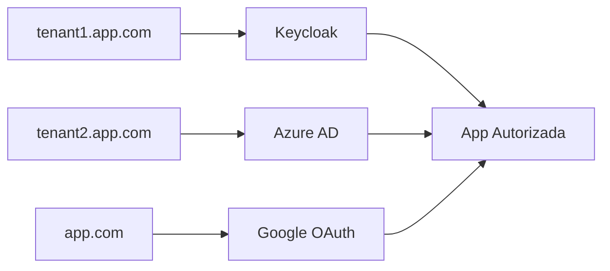

# Single sign On
In AWE applications you can use SSO authentication method. This feature allows a user to utilize a single account to access different apps (user name and password).

To run the identity provider as the only sign-in path, see [IdP-first security mode](idp-first.md).

## Azure EntraID
AWE provide Azure oauth2 authentication service integration using native `spring-cloud-azure-starter-active-directory`. Uses the Spring Boot Starter for Microsoft Entra ID enables you to connect your web application to a Microsoft Entra tenant and protect your resource server with Microsoft Entra ID. It uses the Oauth 2.0 protocol to protect web applications and resource servers.


To enable Azure oauth2 active directory, you have to add spring-cloud-azure starter and configure your organization tenantId and application ID and secret.

```xml title="Add dependency"
    <dependency>
      <groupId>com.azure.spring</groupId>
      <artifactId>spring-cloud-azure-starter-active-directory</artifactId>
    </dependency>
```
```properties title="Configure azure EntraID properties"
# Enable related features.
spring.cloud.azure.active-directory.enabled=true
# Specifies your Active Directory ID:
spring.cloud.azure.active-directory.profile.tenant-id={CONFIGURE YOUR TENANT ID}
# Specifies your App Registration's Application ID:
spring.cloud.azure.active-directory.credential.client-id={CONFIGURE YOUR CLIENT ID}
# Specifies your App Registration's secret key:
spring.cloud.azure.active-directory.credential.client-secret={CONFIGURE YOUR SECRET KEY}
```

:::info You can visit [this](https://learn.microsoft.com/en-us/azure/developer/java/spring-framework/spring-boot-starter-for-azure-active-directory-developer-guide?tabs=SpringCloudAzure4x) for more info. 
:::

By default, if the user logged in the application with this  doesn't exist in database, it  will be provisioned by registering it by adding a new record in the user table.
If you do not want this behavior, you can disable it setting false the configuration property `awe.security.sso.auto-provision-user`.

## Disabled and locked users

AWE keeps the final say on who can enter the application. If the user that the identity provider has just
authenticated already exists in AWE and is **disabled** or **locked**, the SSO login is rejected: no AWE session is
created, the authentication is discarded and the user sees an error page explaining that the user is disabled or
locked in the application. The provider cannot be used to bypass those flags.

- Users that do not exist in AWE yet follow the auto-provisioning rules above.
- Password expiration does not apply to SSO logins, since the password is not used. Account expiration is not checked either, because AWE has no account-expiry column.
- Each rejection is logged as a warning with the user name.

## Switching off local login

By default AWE keeps its own username and password login active when SSO is enabled. To make the identity provider
the only way in, set:

```properties
awe.security.sso.enabled=true
awe.security.sso.local-login=false
```

With `awe.security.sso.local-login=false` (default `true`) and SSO enabled:

- The sign-in screen hides the user, password and **Log in** controls in both the AngularJS and the React clients, so
  only the SSO buttons remain.
- The three login entry points refuse every user who is not a break-glass user (below): `POST /action/login`,
  `POST /api/authenticate` and the standard Spring form login. They share one authentication manager that applies
  the policy. The shared `AuthenticationManager` bean that internal flows use (for example re-authentication) is not
  affected, and with SSO off or `local-login=true` the login requests reach the real providers unchanged.
- A refused user gets **exactly the same response as a wrong password** (same status, title and message), so the
  failure cannot be used to find out which users are break-glass users. A refusal still runs the real authentication
  with a throw-away password, so it costs about the same as a wrong password, it can never succeed, and it publishes
  the same bad-credentials failure event for audit or lockout listeners. The real reason is only written to the
  server log, as a `WARN` line with the user name (sanitized, never the password).

The switch has no effect when SSO is disabled, so it can never lock everybody out of an application without a provider.
An application can replace the policy by declaring its own `LocalLoginPolicy` bean.

### Break-glass users

If the identity provider is down you still need a way in. List the AWE users that may keep signing in locally:

```properties
awe.security.sso.local-login=false
awe.security.sso.break-glass-users=admin
```

- The list is empty by default: nobody can sign in locally when the switch is off.
- User names are trimmed and compared **exactly** (case-sensitive). The name that was checked is the name that is
  authenticated. Several names are separated by commas; spaces and blank entries are ignored.
- A break-glass user still goes through the normal account checks: a locked or expired account is refused.
- A break-glass user opens the local sign-in screen at `/screen/public/signin-local` (for example
  `https://my-app.example.com/screen/public/signin-local`) and signs in with the normal local credentials. The screen is
  always reachable and only shows the user and password form; showing it grants nothing, because the server still
  refuses everybody who is not in the list, with the same message as a wrong password.
- Each break-glass login attempt is logged at `WARN` level with the `[break-glass]` tag and the user name, so you can
  alert on it. Refusals are logged at `WARN` too, without the tag.
- Keep the list short, use strong passwords and treat every `[break-glass]` entry in the log as an event to review.

## Back-channel logout

By default an AWE session lives until it expires or the user logs out of AWE: ending the session at the identity
provider (an administrator signs the user out, the user is disabled, or the user logs out of another application)
does not reach AWE. With [OpenID Connect back-channel logout](https://openid.net/specs/openid-connect-backchannel-1_0.html)
the provider tells AWE directly, server to server, and AWE ends the matching sessions at once.

```properties
awe.security.sso.enabled=true
awe.security.sso.back-channel-logout.enabled=true
```

| Property | Default | Meaning |
| --- | --- | --- |
| `awe.security.sso.back-channel-logout.enabled` | `false` | Registers the back-channel logout endpoint. Ignored when SSO is disabled. |
| `awe.security.sso.back-channel-logout.logout-uri` | empty (`{baseUrl}/logout/connect/back-channel/{registrationId}`) | Address AWE calls on itself to end each session (see below). |
| `awe.security.sso.back-channel-logout.connect-timeout` | `2s` | Connection timeout of that internal call. |
| `awe.security.sso.back-channel-logout.read-timeout` | `5s` | Read timeout of that internal call. |

How it works:

- At every SSO login AWE records the provider session (`sid` claim) and the user (`sub` claim) of the ID token
  together with the AWE session id, in an OIDC session registry.
- The provider posts a signed logout token to `/logout/connect/back-channel/{registrationId}`, where
  `{registrationId}` is the Spring client registration (for example
  `/logout/connect/back-channel/keycloak` for `spring.security.oauth2.client.registration.keycloak.*`). AWE validates
  the token with the provider keys (signature, issuer, audience and the back-channel logout event) and answers
  `400` when it is not valid.
- For each AWE session of that provider session (or of that user, when the token carries no `sid`), AWE sends an
  internal logout request to the `logout-uri` with the session cookie. It runs the same logout handlers as a user
  logout: the AWE session data is cleared, the browser tabs of that session receive a logout message through the
  websocket and their connections are released, and the HTTP session is invalidated. The next request of the browser
  goes to the sign-in flow.
- The internal call is bounded by `connect-timeout` and `read-timeout`, so an unreachable `logout-uri` cannot hang the
  provider request. A session whose call fails or times out stays registered and the provider gets an error answer.
- The endpoint is excluded from the CSRF check, as the provider cannot send a CSRF token.

Configure the provider to call the endpoint:

- **Keycloak:** in the client settings, set **Backchannel logout URL** to
  `https://{hostname}/logout/connect/back-channel/{registrationId}` and keep **Backchannel logout session required**
  on, so the logout token carries the `sid` of the session.
- **Microsoft Entra ID:** Entra ID only supports front-channel logout, so back-channel logout cannot be used with it
  directly. Broker Entra ID through Keycloak to get it, or keep a short session timeout.

:::caution Things to check before enabling it
- **The internal logout request must reach this same node.** By default it goes to the address the provider used
  (`{baseUrl}`). When that public address is not reachable from the server (a proxy, a load balancer or a firewall in
  between), set `logout-uri`, for example
  `http://localhost:8080{basePath}/logout/connect/back-channel/{registrationId}`. Placeholders: `{baseUrl}`,
  `{baseScheme}`, `{baseHost}`, `{basePort}`, `{basePath}` and `{registrationId}`.
- **Session cookie name.** The internal request sends the cookie named by `session.cookie.name` (default
  `JSESSIONID`), the same one AWE deletes on logout. Keep it equal to the real session cookie name.
- **Registry size.** An entry leaves the registry when its session is ended by the provider, and also when the
  HTTP session expires or is invalidated (user logout, timeout) and when its id changes at login: AWE registers an
  `HttpSessionEventPublisher` and Spring Security listens to its session events. If the application replaces that
  publisher or its session store does not raise HTTP session events, entries of expired sessions are kept.
- **Several nodes.** The default registry is kept in memory and only knows the sessions created in the node that
  receives the logout token. In a cluster, declare a shared `OidcSessionRegistry` bean (AWE then uses it) and make sure
  the internal request reaches the node that holds the session, or that sessions are shared.
- **Spring Session.** If the application stores sessions with Spring Session and its cookie serializer encodes the
  session id in Base64 (the Spring Session default), the raw session id sent by the internal request is not
  recognized. Turn off the Base64 encoding of the cookie serializer, or declare a bean that extends
  `AweOidcBackChannelLogoutHandler` and overrides `sessionCookieValue(String)` to encode the id the same way.
:::

## Role mapping and profile synchronization

On every SSO login, AWE maps the granted authorities coming from the identity provider to a profile, using
`awe.security.sso.filter-authority-prefix` to select and strip the role claim (see above).

### Roles claim

The roles are read from the ID token claims listed in `awe.security.sso.roles-claims`, in order (default
`realm_access.roles`, the Keycloak realm roles). A dotted name walks nested objects, unless the token has a claim with
that exact name (so URI claim names work). A claim can hold a list of roles or a single text role.

| Provider | Claim | Property |
| --- | --- | --- |
| Keycloak, realm roles | `realm_access.roles` | default, nothing to set |
| Keycloak, client roles | `resource_access.<client-id>.roles` | `awe.security.sso.roles-claims=resource_access.my-app.roles` |
| Microsoft Entra ID, app roles | `roles` | `awe.security.sso.roles-claims=roles` |
| Several sources | all of them, joined | `awe.security.sso.roles-claims=roles,realm_access.roles` |

- The claims must be in the **ID token**: in Keycloak, keep **Add to ID token** on in the roles mappers; in Entra ID,
  app roles assigned to the user are sent in the `roles` claim of the ID token.
- Entra ID `groups` carries group object ids, not names; prefer app roles.
- Only claim names and role counts are logged (at `DEBUG`), never role values.
- An application that declares its own `realmRolesAuthoritiesConverter` bean keeps full control and
  `roles-claims` is ignored.

### Several roles: which profile wins

All roles that carry the prefix are turned into profile names (the prefix is stripped, roles equal to the prefix are
ignored). When more than one remains, AWE uses the **first name in alphabetical order that exists as an AWE
profile**, so the result never depends on the order in which the provider sends the roles, and a role without a
profile never hides a valid one. When none of them exists as a profile, the first name in alphabetical order is
taken (and then handled as a role without profile, see below). For example, with the prefix `role_` and the roles
`role_operator`, `role_manager` and `role_auditor`, where `auditor` is not an AWE profile, the profile is `manager`.
To control the result, send a single prefixed role per user, or name the profiles so that the preferred one sorts
first.

### Synchronization with the stored profile

- If the provider sends a role that matches the prefix, and it differs from the user's stored profile, the
  profile is synchronized (only when the role exists in the application).
- If the provider sends no role (no authorities, none matching the prefix, or an authority equal to the prefix
  itself), the behaviour depends on the user:
  - **New, auto-provisioned users** are always created with `awe.application.default-role`.
  - **Existing users** keep their current database profile untouched, so a profile assigned manually in AWE
    is not silently reset on the next login.

When a role is required (below), none of these fallbacks apply.

```yaml title="Restore the default role on missing SSO roles"
awe:
  security:
    sso:
      overwrite-profile-with-default-role: true
```

:::caution Behaviour change since 4.12.9
Prior to 4.12.9, an existing user without a matching SSO role was always downgraded to
`awe.application.default-role` on every login, overwriting any profile assigned manually. Since 4.12.9 the
existing profile is kept by default. Set `awe.security.sso.overwrite-profile-with-default-role=true` to restore
the previous behaviour.
:::

### Requiring a role (fail closed)

When a role is required, an SSO login is **refused** when no role sent by the provider maps to an existing AWE
profile: the user sees an error page with a localized message ("Your identity provider account has no role allowed
in this application..."), no AWE session is created, nothing is provisioned, and `awe.application.default-role` is
not used. The refusal is logged at `WARN` with the user name.

- **Only in IdP-first by default.** A role is required by default only when local login is switched off
  (`awe.security.sso.local-login=false`). With local login on (the default), the previous behaviour stays unless
  `awe.security.sso.require-role=true` is set. An explicit `require-role` always wins.
- **Existing users are refused too.** An AWE user that already exists is refused in the same way: the profile stored
  in AWE is **not** used as a fallback when the provider sends no role that maps to a profile.

| `local-login` | `require-role` | Result when no role maps |
| --- | --- | --- |
| `true` (default) | not set (default) | Previous behaviour: stored profile kept, or default role for new users (see above). |
| `false` (IdP-first) | not set (default) | **Refused.** |
| any | `true` | Refused. |
| any | `false` | Previous behaviour (explicit opt-in to the default role fallback). |

A role "maps" when, after the prefix and the alphabetical rule above, the resulting name exists as an AWE profile.

## Keycloak


Configure the client by setting the Root URL, Web origins, Admin URL to the hostname (https://\{hostname}).

Also you can set Home URL to /applications path and Valid Post logout redirect URIs to "https://\{hostname}/applications".

The Valid Redirect URIs should be set to https://\{hostname}/auth/callback (you can also set the less secure https://\{hostname}/* for testing/development purposes, but it's not recommended in production).


Make sure to click Save.

There should be a tab called Credentials. You can copy the Client Secret that we'll use in our app configuration.


The following configuration properties need to be added to integrate an AWE application with the Keycloak server

```properties title="Configure keycloak oauth client properties"
################################################
# SSO login
################################################
# Enable AWE SSO
awe.security.sso.enabled=true
# Auto launch sso flow (skip native window sign in)
awe.security.sso.auto-launch=true
# Filter authority prefix (used to filtering granted authorities in post authentication process)
awe.security.sso.filter-authority-prefix=role_
# Enable generic SSO button in login screen
awe.security.sso.enable-generic-sso-button=true

# Provider issuer uri
spring.security.oauth2.client.provider.keycloak.issuer-uri=[PROVIDER_URI]
# Oauth provider name
spring.security.oauth2.client.registration.keycloak.provider=keycloak
# Authorization grant type for login
spring.security.oauth2.client.registration.keycloak.authorization-grant-type=authorization_code
# Client Id
spring.security.oauth2.client.registration.keycloak.client-id=[CLIENT_ID]
# Client Secret
spring.security.oauth2.client.registration.keycloak.client-secret=[CLIENT_SECRET]
# Scope request
spring.security.oauth2.client.registration.keycloak.scope=openid
# Redirect URI
spring.security.oauth2.client.registration.keycloak.redirect-uri={baseUrl}/login/oauth2/code/keycloak
```

## Multi-Tenant SSO


AWE Framework supports multi-tenant SSO authentication, allowing different organizations or clients to use the same application instance with their own separate OAuth2 configurations. Each tenant can have its own identity provider settings while sharing the same application codebase.

### How Multi-Tenant Works

The multi-tenant functionality in AWE uses **subdomain-based tenant resolution**. When a user accesses the application through different subdomains, the system automatically determines which tenant configuration to use:

- `tenant1.yourdomain.com` → Uses "tenant1" configuration
- `tenant2.yourdomain.com` → Uses "tenant2" configuration  
- `yourdomain.com` → Uses default tenant configuration


### Configuration

To enable multi-tenant SSO, you need to configure the following properties:

```properties title="Enable Multi-Tenant SSO"
# Enable multi-tenant functionality
awe.security.sso.multitenant.enabled=true

# Set the default tenant (used when no specific tenant is detected)
awe.security.sso.multitenant.default-tenant=public
```

### Tenant-Specific Configuration

Each tenant requires its own OAuth2 registration and provider configuration using standard Spring Security OAuth2 properties. The configuration follows this pattern:

```properties title="Multi-Tenant Configuration Pattern"
# Provider configuration for a tenant
spring.security.oauth2.client.provider.{tenant-name}.issuer-uri={PROVIDER_ISSUER_URI}
spring.security.oauth2.client.provider.{tenant-name}.user-name-attribute=preferred_username

# Registration configuration for a tenant
spring.security.oauth2.client.registration.{tenant-name}.provider={tenant-name}
spring.security.oauth2.client.registration.{tenant-name}.client-id={CLIENT_ID}
spring.security.oauth2.client.registration.{tenant-name}.client-secret={CLIENT_SECRET}
spring.security.oauth2.client.registration.{tenant-name}.authorization-grant-type=authorization_code
spring.security.oauth2.client.registration.{tenant-name}.scope=openid,profile,email
spring.security.oauth2.client.registration.{tenant-name}.redirect-uri={baseUrl}/login/oauth2/code/{tenant-name}
spring.security.oauth2.client.registration.{tenant-name}.client-name={CLIENT_DISPLAY_NAME}
```

### Complete Example Configuration

Here's a complete example showing how to configure multiple tenants:

```properties title="Complete Multi-Tenant Example"
################################################
# Multi-Tenant SSO Configuration
################################################
# Enable SSO authentication
awe.security.sso.enabled=true
# Auto launch sso flow (skip native window sign in)
awe.security.sso.auto-launch=true
# Filter authority prefix (used to filtering granted authorities in post authentication process)
awe.security.sso.filter-authority-prefix=role_


# Enable multi-tenant functionality
awe.security.sso.multitenant.enabled=true
awe.security.sso.multitenant.default-tenant=public

# Default tenant configuration (public.yourdomain.com or yourdomain.com)
# Provider
spring.security.oauth2.client.provider.public.issuer-uri=http://localhost:8081/realms/public

# Registration
spring.security.oauth2.client.registration.public.provider=public
spring.security.oauth2.client.registration.public.client-id={awe-public-client}
spring.security.oauth2.client.registration.public.client-secret={your-public-client-secret}
spring.security.oauth2.client.registration.public.authorization-grant-type=authorization_code
spring.security.oauth2.client.registration.public.scope=openid,profile,email
spring.security.oauth2.client.registration.public.redirect-uri={baseUrl}/login/oauth2/code/public
spring.security.oauth2.client.registration.public.client-name=AWE Public

# Company A tenant configuration (companyA.yourdomain.com)
# Provider
spring.security.oauth2.client.provider.companyA.issuer-uri=http://localhost:8081/realms/companyA

# Registration
spring.security.oauth2.client.registration.companyA.provider=companyA
spring.security.oauth2.client.registration.companyA.client-id={awe-companyA-client}
spring.security.oauth2.client.registration.companyA.client-secret={your-companyA-client-secret}
spring.security.oauth2.client.registration.companyA.authorization-grant-type=authorization_code
spring.security.oauth2.client.registration.companyA.scope=openid,profile,email
spring.security.oauth2.client.registration.companyA.redirect-uri={baseUrl}/login/oauth2/code/companyA
spring.security.oauth2.client.registration.companyA.client-name=AWE Company A

# Company B tenant configuration (companyB.yourdomain.com)
# Provider
spring.security.oauth2.client.provider.companyB.issuer-uri=http://localhost:8081/realms/companyB
spring.security.oauth2.client.provider.companyB.user-name-attribute=preferred_username

# Registration
spring.security.oauth2.client.registration.companyB.provider=companyB
spring.security.oauth2.client.registration.companyB.client-id={awe-companyB-client}
spring.security.oauth2.client.registration.companyB.client-secret={your-companyB-client-secret}
spring.security.oauth2.client.registration.companyB.authorization-grant-type=authorization_code
spring.security.oauth2.client.registration.companyB.scope=openid,profile,email
spring.security.oauth2.client.registration.companyB.redirect-uri={baseUrl}/login/oauth2/code/companyB
spring.security.oauth2.client.registration.companyB.client-name=AWE Company B
```

### Multi-Tenant with Different Identity Providers

You can also configure different tenants to use completely different identity providers:

```properties title="Mixed Identity Providers Example"
# Tenant using Keycloak
spring.security.oauth2.client.provider.keycloak-tenant.issuer-uri=http://keycloak.example.com/realms/tenant1
spring.security.oauth2.client.registration.keycloak-tenant.provider=keycloak-tenant
spring.security.oauth2.client.registration.keycloak-tenant.client-id=keycloak-client
spring.security.oauth2.client.registration.keycloak-tenant.client-secret=keycloak-secret
spring.security.oauth2.client.registration.keycloak-tenant.authorization-grant-type=authorization_code
spring.security.oauth2.client.registration.keycloak-tenant.scope=openid,profile,email
spring.security.oauth2.client.registration.keycloak-tenant.redirect-uri={baseUrl}/login/oauth2/code/keycloak-tenant

# Tenant using Azure EntraID
spring.security.oauth2.client.provider.azure-tenant.issuer-uri=https://login.microsoftonline.com/{tenant-id}/v2.0
spring.security.oauth2.client.registration.azure-tenant.provider=azure-tenant
spring.security.oauth2.client.registration.azure-tenant.client-id=azure-client-id
spring.security.oauth2.client.registration.azure-tenant.client-secret=azure-client-secret
spring.security.oauth2.client.registration.azure-tenant.authorization-grant-type=authorization_code
spring.security.oauth2.client.registration.azure-tenant.scope=openid,profile,email
spring.security.oauth2.client.registration.azure-tenant.redirect-uri={baseUrl}/login/oauth2/code/azure-tenant

# Tenant using Google
spring.security.oauth2.client.provider.google-tenant.issuer-uri=https://accounts.google.com
spring.security.oauth2.client.registration.google-tenant.provider=google-tenant
spring.security.oauth2.client.registration.google-tenant.client-id=google-client-id
spring.security.oauth2.client.registration.google-tenant.client-secret=google-client-secret
spring.security.oauth2.client.registration.google-tenant.authorization-grant-type=authorization_code
spring.security.oauth2.client.registration.google-tenant.scope=openid,profile,email
spring.security.oauth2.client.registration.google-tenant.redirect-uri={baseUrl}/login/oauth2/code/google-tenant
```

### DNS Configuration

For subdomain-based tenant resolution to work, you need to configure your DNS to point all subdomains to your application:

```bash title="DNS Configuration Example"
# Main domain
yourdomain.com        A    192.168.1.100

# Wildcard subdomain (points all subdomains to the same server)
*.yourdomain.com      A    192.168.1.100
```

### Benefits of Multi-Tenant SSO

- **Isolation**: Each tenant has its own authentication configuration
- **Flexibility**: Different tenants can use different identity providers
- **Scalability**: Single application instance serves multiple organizations
- **Maintenance**: Centralized application updates benefit all tenants
- **Security**: Tenant configurations are completely separated

::::info
The multi-tenant functionality automatically handles tenant resolution based on the request subdomain. If a tenant is not configured, the system falls back to the default tenant configuration.
::::

::::warning
Make sure to properly configure your DNS and SSL certificates to support wildcard subdomains when using multi-tenant functionality.
::::

### Add identity providers
You can integrate others identity provider to use in your authentication process. In this guide, we use Azure EntraID as example.


In the detail page, fill out the details as required below:
* Enter the alias of your choice. Enable use discovery endpoint, if not already enabled
* Input the Discovery URL from Azure (copied before) into the Discovery endpoint


* Input the Client ID. This is the application (client) ID copied from Azure app registration.
* Input Client Secret. This is the application secret copied from Azure app registration


### Mappers

When configuring roles/groups, the process is a bit more tedious since the claims used for this are not standard. Each provider uses a different method.

In order to collect the information sent to us by the provider, we will have to create some mappers that retrieve the information and translate it into the keycloak environment.

- Group mappers

By default, Azure EntraID does not display the groups associated with each user. In order to retrieve the groups to which a user belongs, it is necessary to configure Azure to send a custom claim `groups` with token type ClientID.


Then, you have to create a new mapper for identity provider to map user group objectId to keycloak role.


- App role mappers

In order to retrieve the app roles of an application registered in Azure EntraID, it is necessary to create an `advanced claim custom role mapper` that maps the claim *role* key with the name of application role in Azure with the keycloak role.


