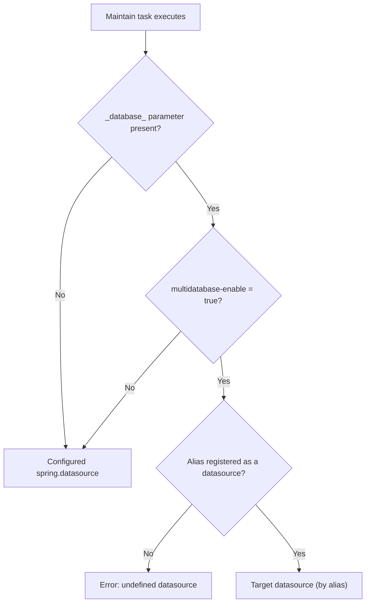

import Tabs from '@theme/Tabs';
import TabItem from '@theme/TabItem';

Este documento ofrece una base mínima para empezar con el módulo Scheduler de AWE, y explica cómo automatizar y planificar tareas dentro de AWE de forma sencilla.

El módulo Scheduler está basado en la librería Quartz Scheduler.

Toda la documentación relacionada con la librería Quartz Scheduler se puede encontrar en su [página web](https://quartz-scheduler.org/documentation).

## Requisitos previos {#prerequisites}

El módulo scheduler necesita ser configurado antes de usarse.

Para ver cómo configurar el módulo scheduler en tu aplicación consulta la **[guía de configuración](../scheduler-module.md)**.

## Configuración del planificador remoto {#remote-scheduler-setup}

Puedes separar el planificador en una instancia de AWE dedicada y hacer que tu aplicación AWE principal le delegue la planificación.

### 1. Configurar la instancia del planificador {#1-configure-the-scheduler-instance}

En el nodo dedicado al planificador, habilita el modo solo planificador y configura la devolución de llamada (callback) hacia tu aplicación AWE principal:

```properties
# Scheduler-only instance
awe.scheduler.scheduler-instance=true

# Callback to the main AWE instance
awe.scheduler.remote-callback-url=http://localhost:8080
awe.scheduler.remote-callback-secure-enabled=true
awe.scheduler.remote-callback-user=scheduler
awe.scheduler.remote-callback-password=ENC(yourEncryptedPassword)
```

### 2. Configurar la instancia principal de AWE {#2-configure-the-main-awe-instance}

En la aplicación AWE principal, habilita el uso del planificador remoto y apunta a la URL base de la API del planificador:

```properties
awe.scheduler.remote-enabled=true
awe.scheduler.remote-scheduler-url=http://localhost:8090/scheduler/api/v1
```

> **Nota:** La URL base del planificador remoto debe apuntar a la API de la instancia del planificador (por defecto: `/scheduler/api/v1`).

:::warning Cambio incompatible: la API del planificador ahora exige autenticación
La instancia del planificador ahora solo responde a `/scheduler/api/**` a las peticiones con un token bearer de AWE, y la instancia del planificador necesita el [starter de AWE REST](../rest-module.md) para validarlo. Por tanto, la instancia principal de AWE debe iniciar sesión con un usuario de la instancia del planificador, configurado en `awe.scheduler.remote-scheduler-user` y `awe.scheduler.remote-scheduler-password`. Consulta [Seguridad de la API del planificador](../scheduler-module.md#scheduler-api-security).
:::


* **[Tareas](#tasks)**
* **[Servidores](#servers)**
* **[Calendarios](#calendars)**

| Para | Abre | Pantalla |
|------|------|----------|
| Ver lo que se ejecuta, espera o ha fallado | **Actividad** | `scheduler-activity` |
| Crear, editar, ejecutar o borrar una tarea | **Tareas**, y después la tarea | `scheduler-task-catalog`, `scheduler-task` y `scheduler-task-editor` |
| Seguir una ejecución de flujo | Un enlace de flujo de Actividad o de la tarea | `scheduler-flow-run` |
| Gestionar servidores, calendarios o el motor | **Configuración** | `scheduler-configuration` |
    

## Tareas {#tasks}

Una tarea consiste en un trabajo asociado a un disparador que es ejecutado por el planificador en el momento configurado.

Una tarea también puede encadenarse con otras tareas para crear un flujo de trabajo. Se hace en cada tarea que se ejecuta después: **Cuándo** › **Después de otras tareas** del [editor de tareas](#configuration) elige las tareas tras las que se ejecuta (consulta [Dependencias entre tareas](dependencies-guide.md)).

### Tipos {#types}

Hay dos tipos de tareas con los que puede trabajar el planificador: las tareas maintain y las tareas de comando.

| Tarea maintain                                                       | Tarea de comando                                                                                                      |
|----------------------------------------------------------------------|:---------------------------------------------------------------------------------------------------------------------|
| Una tarea maintain ejecuta un maintain público con una planificación definida. | Una tarea de comando ejecuta un comando de shell con una planificación definida, ya sea en el host local de AWE o en un host remoto mediante SSH. |

### Ejecución de comandos: local y remota {#command-execution-local-and-remote}

Una tarea de comando ejecuta el valor introducido en el campo **Command** como un comando de shell. La **Execution path**, cuando se define, se usa como *directorio de trabajo* en el que se ejecuta el comando, y también actúa como ubicación alternativa para el propio comando: el comando se busca primero en el `PATH` del host, y solo cuando el `PATH` no lo proporciona se usa un archivo ejecutable con ese nombre dentro de la ruta de ejecución. Por tanto, un script que viva en la ruta de ejecución se ejecuta por su nombre simple, mientras que un comando del sistema como `ls` o `python` siempre se sigue resolviendo desde el `PATH` y nunca queda oculto por un archivo del mismo nombre en la ruta de ejecución. Un comando que ya contiene un separador de ruta (`./my-script.sh`, o una ruta absoluta) se usa exactamente como está escrito.

- **Ejecución local** (por defecto): cuando **Run on remote server** se deja sin marcar, el comando se ejecuta en el propio host de AWE.
- **Ejecución remota mediante SSH**: cuando **Run on remote server** está marcado, hay que seleccionar un **Remote server**. El comando se ejecuta en ese host a través de un canal de ejecución SSH, y tanto su salida estándar como su salida de error se capturan en el registro de ejecución de la tarea.

La ejecución remota de comandos requiere que el servidor seleccionado use el tipo de conexión `ssh`. La autenticación se realiza con el usuario del servidor junto con una contraseña, una clave privada (opcionalmente protegida con frase de contraseña), o ambas. Consulta **[Servidores](#servers)** para ver cómo configurarlos, y la **[guía de configuración](../scheduler-module.md#ssh-remote-command-execution)** para las opciones de verificación de claves de host SSH.

### Ejecuciones diferidas {#deferred-executions}

Una tarea maintain puede finalizar más tarde. Sirve para trabajo que otro sistema completa después de que el maintain devuelva su respuesta, y para el que no conviene mantener ocupado un hilo del planificador. El maintain responde que ha aceptado el trabajo, la ejecución queda **en ejecución** sin retener ningún hilo, y el otro sistema (o tu propio código) completa la ejecución cuando el trabajo termina.

1. El planificador lanza el maintain, que inicia el trabajo en el otro sistema y responde **diferido**.
2. El planificador libera su hilo. La ejecución sigue **en ejecución** y no se lanzan sus dependencias.
3. Cuando el trabajo termina, quien lo ha terminado completa la ejecución con su estado final (consulta [Completar la ejecución](#completing-the-execution)).
4. Las dependencias de la tarea se lanzan con las reglas habituales (`Launch dependencies in case of warning` / `in case of error`).

#### La respuesta diferida {#the-deferred-answer}

Un maintain responde diferido cuando su último paso es un servicio que devuelve `SchedulerDeferred.accepted(externalReference, description)`:

```java
public ServiceData startExternalWork(Integer taskId, Integer executionId) {
  // Start the work and hand the execution key to the system that will complete it
  String reference = externalSystem.start(taskId, executionId);
  return SchedulerDeferred.accepted(reference, "Waiting for the external system");
}
```

```xml
<!-- Services.xml -->
<service id="startExternalWork">
  <java classname="com.example.ExternalWorkService" method="startExternalWork">
    <service-parameter name="taskId" type="INTEGER"/>
    <service-parameter name="executionId" type="INTEGER"/>
  </java>
</service>

<!-- Maintain.xml -->
<target name="startExternalWork">
  <serve service="startExternalWork">
    <variable id="taskId" type="INTEGER" name="taskId"/>
    <variable id="executionId" type="INTEGER" name="executionId"/>
  </serve>
</target>
```

Después crea una tarea maintain que ejecute el maintain `startExternalWork`.

- La respuesta diferida debe ser la respuesta del **último paso** del maintain.
- Funciona igual cuando el planificador se ejecuta como [aplicación externa](#remote-scheduler-setup): la respuesta vuelve a la instancia del planificador con la respuesta de la llamada al maintain.
- `externalReference` es una referencia opcional del trabajo en el otro sistema, que se guarda con la ejecución. Se recorta a 256 caracteres.
- `description` es opcional. Se muestra como descripción de la ejecución mientras espera, y se recorta a 2000 caracteres.

#### La clave de la ejecución {#the-execution-key}

El planificador da a cada maintain dos parámetros reservados: `taskId` y `executionId`. Declara variables con esos nombres en el target del maintain, como en el ejemplo anterior, para recibirlos. Identifican la ejecución, así que el maintain debe entregarlos a quien vaya a completarla. Tienen prioridad sobre un parámetro de la tarea con el mismo nombre.

#### Mientras la ejecución espera {#while-the-execution-waits}

- La ejecución se guarda como **en ejecución** con la descripción de la respuesta diferida.
- No se lanzan las dependencias de la tarea y la ejecución se muestra como **Esperando confirmación** en la [pantalla de actividad](#activity-screen).
- No se retiene ningún hilo del planificador.

#### Completar la ejecución {#completing-the-execution}

El sistema que termina el trabajo llama a la API del planificador (a la instancia del planificador cuando usas un [planificador remoto](#remote-scheduler-setup)):

```text
POST /scheduler/api/v1/tasks/{taskId}/executions/{executionId}/complete
```

La petición necesita un token bearer de AWE, como el resto de `/scheduler/api/**` (consulta [Seguridad de la API del planificador](../scheduler-module.md#scheduler-api-security)). El cuerpo es un objeto JSON:

| Campo         | Descripción                                                                                           |      Obligatorio     |
|---------------|:------------------------------------------------------------------------------------------------------|:--------------------:|
| `status`      | Estado final: `OK`, `WARNING`, `ERROR`, `STOPPED`, `INTERRUPTED` o `INFO` (sin distinguir mayúsculas) |   **Obligatorio**    |
| `description` | Descripción de la ejecución, 2000 caracteres como máximo                                              |       Opcional       |
| `outputs`     | Objeto con valores de texto para las dependencias (consulta [Salidas](#outputs))                      |       Opcional       |

```bash
curl -X POST "https://scheduler.example.com/scheduler/api/v1/tasks/12/executions/340/complete" \
  -H "Authorization: Bearer $TOKEN" -H "Content-Type: application/json" \
  -d '{"status": "OK", "description": "Calculation finished"}'
```

| Respuesta | Significado                                                                                                                  |
|:---------:|:-----------------------------------------------------------------------------------------------------------------------------|
|    200    | La ejecución se ha completado. El cuerpo es `{"taskId": 12, "executionId": 340, "status": "JOB_OK"}`                         |
|    400    | Falta el `status` o no es uno de los valores permitidos, o la `description` supera los 2000 caracteres                       |
|    401    | La petición no tiene un token bearer válido                                                                                  |
|    404    | La ejecución no existe                                                                                                       |
|    409    | La ejecución no se puede completar. El cuerpo es `{"type": "...", "currentStatus": "JOB_OK"}`, con uno de los tipos siguientes |

| `type` del 409           | Significado                                                                                                              |
|--------------------------|:-------------------------------------------------------------------------------------------------------------------------|
| `execution-not-running`  | La ejecución ya se completó, se interrumpió por su plazo o se detuvo. `currentStatus` es el estado que tiene             |
| `execution-not-deferred` | La ejecución no está registrada como diferida, así que no se puede completar desde fuera. Con `currentStatus` `JOB_RUNNING` puede que el maintain aún no haya respondido: reintenta en breve si esperas que sea diferida |

Un `409` con `execution-not-running` es definitivo: la ejecución ya está cerrada y repetir la llamada no la cambiará, así que no lo reintentes.

El estado decide qué ocurre con las dependencias, con las reglas habituales: se lanzan tras `OK`, tras `WARNING` solo con `Launch dependencies in case of warning`, tras `ERROR` solo con `Launch dependencies in case of error`, y nunca tras `STOPPED`, `INTERRUPTED` o `INFO`. El planificador cierra la ejecución una sola vez, escribe su fin, envía el informe de la tarea y lanza las dependencias; cualquier otra finalización de la misma ejecución no hace nada.

El código que se ejecuta en la misma aplicación que el planificador puede completar la ejecución sin la API, con el bean `SchedulerExecutionCompletionService`:

```java
CompletionResult result = completionService.complete(taskId, executionId, TaskStatus.JOB_OK,
  "Calculation finished", null);
// result.outcome(): CLOSED, NOT_RUNNING, NOT_DEFERRED or UNKNOWN
```

#### Salidas {#outputs}

Los `outputs` de la finalización llegan a las dependencias que se lanzan cuando se cierra la ejecución, igual que los demás valores de la tarea padre: cada dependencia toma el valor de cada salida cuyo nombre coincide con uno de sus parámetros **variables**. Una salida sustituye a un parámetro de la tarea cerrada con el mismo nombre, y una salida sin nombre o sin valor se ignora.

```bash
curl -X POST "https://scheduler.example.com/scheduler/api/v1/tasks/12/executions/340/complete" \
  -H "Authorization: Bearer $TOKEN" -H "Content-Type: application/json" \
  -d '{"status": "OK", "outputs": {"resultFile": "/data/out/340.csv"}}'
```

Una dependencia con un parámetro variable `resultFile` se ejecuta con `/data/out/340.csv`.

#### Plazo, parada y reinicio {#deadline-stop-and-restart}

- **Plazo**: una ejecución que no se completa dentro del **Timeout** de la tarea, o dentro de `awe.scheduler.deferred.default-timeout` (24 horas por defecto) cuando la tarea no tiene ninguno, contado desde el inicio de la ejecución, termina como **interrumpida** con el mensaje de timeout y no se lanzan sus dependencias. El planificador comprueba los plazos cada `awe.scheduler.deferred.timeout-check-interval` (60 segundos por defecto), así que la ejecución puede terminar después de su plazo hasta ese intervalo. Una finalización que llegue más tarde recibe un `409`. Consulta la **[guía de configuración](../scheduler-module.md#deferred-executions)**.
- **Parada**: la acción de detener del panel lateral de la ejecución (Actividad, el historial de la tarea y la página del flujo) termina la ejecución en espera como **detenida**, sin lanzar dependencias.
- **Reinicio y clúster**: el estado de una ejecución en espera se guarda en la base de datos, así que sobrevive a un reinicio. Al arrancar, el planificador interrumpe las ejecuciones que un nodo detenido dejó en marcha, salvo las que esperan a ser completadas. Todos los nodos comprueban los plazos y cualquier nodo puede recibir la finalización, pero solo la primera llamada que cierra una ejecución la termina.

#### Aviso de cancelación {#cancellation-notice}

Cuando un usuario detiene una ejecución diferida o se supera su plazo, el otro sistema puede seguir trabajando en ella. Rellena **Mantenimiento de cancelación** en la tarea (solo en tareas de mantenimiento) para avisarle: la llamada que cierra la ejecución lanza ese mantenimiento una sola vez, donde se ejecuta el mantenimiento de la tarea (en la aplicación AWE con un [planificador externo](#remote-scheduler-setup)), con estos parámetros:

| Parámetro           | Valor                                                  |
|---------------------|:-------------------------------------------------------|
| `taskId`            | Identificador de la tarea                              |
| `executionId`       | Identificador de la ejecución                          |
| `externalReference` | El `externalReference` de la respuesta diferida        |

Una finalización por la API o por `SchedulerExecutionCompletionService` no lo envía: el otro sistema cerró la ejecución. El aviso nunca reabre ni bloquea la ejecución: si el mantenimiento falla o responde un error, la ejecución sigue cerrada y el fallo se guarda en su traza.

#### Traza y contadores {#trace-and-counters}

Cada ejecución diferida guarda, tras cerrarse, quién la cerró y cuándo (`API`, `DEADLINE` o `USER`) y el resultado de su aviso de cancelación (`SENT`, o `FAILED` con el mensaje de error). El panel lateral de la ejecución en la [pantalla de actividad](#activity-screen) muestra a qué espera una ejecución en espera y su plazo, su contador **Esperando confirmación** cuenta las ejecuciones que esperan, y la pestaña **Motor** de la pantalla Configuración enlaza con ellas.

### Base de datos de ejecución de la tarea {#task-execution-database}

Una **tarea maintain** se ejecuta contra el datasource configurado mediante las propiedades `spring.datasource.*` de Spring Boot. Este es el caso en **ambos** modos de ejecución:

- **Planificador local (embebido)** &mdash; el maintain se ejecuta sobre el mismo datasource que la aplicación AWE principal.
- **Instancia de planificador remota** &mdash; el maintain se ejecuta sobre el datasource configurado para *esa* instancia del planificador.

:::info ¿Por qué siempre el datasource configurado?
Las tareas del planificador se ejecutan en un hilo de trabajo de Quartz **sin sesión HTTP asociada**. El enrutamiento interactivo multibase de datos en el que se apoya una petición web normal lee su destino del estado de la sesión/pantalla, que simplemente no existe aquí. Por ello, el planificador resuelve la conexión a partir del `spring.datasource` configurado en lugar de cualquier valor de sesión.
:::

:::tip La base de datos de un planificador remoto es una decisión de despliegue
No existe un interruptor por tarea para "ejecutar esta tarea en la base de datos de la aplicación principal". Una instancia de planificador remota usa **su propio** `spring.datasource`. Para que apunte a la misma base de datos que tu aplicación principal, haz que el `spring.datasource.url` de esa instancia (y el usuario, la contraseña, &hellip;) apunten a la misma base de datos.
:::

#### Apuntar a una base de datos diferente {#targeting-a-different-database}

Si una tarea maintain concreta debe ejecutarse contra una base de datos **diferente** de la configurada por defecto, añade un **parámetro de tarea** (consulta [Parámetros de la tarea](#2-task-parameters)) cuyo **nombre sea el criterio de base de datos** y cuyo **valor sea el alias del datasource de destino**.

El nombre del parámetro **no** está fijado a `database`: es el valor de [`awe.database.parameter-name`](../properties.md#awe.database.parameter-name), que por defecto es `_database_`.

<Tabs>
<TabItem value="single" label="Single-database (default)" default>

No hay nada que configurar. Con [`awe.database.multidatabase-enable`](../properties.md#awe.database.multidatabase-enable) establecido a `false` (el valor por defecto), cada tarea se ejecuta contra el único `spring.datasource` configurado, y un parámetro llamado `_database_` se trata como un parámetro ordinario **sin** efecto de enrutamiento.

</TabItem>
<TabItem value="multi" label="Multi-database">

En un despliegue con `awe.database.multidatabase-enable=true`, añade un parámetro de tarea en la sección **Parámetros** del editor de tareas:

| Campo  | Valor                                                        |
|--------|-------------------------------------------------------------|
| Name   | `_database_` (o tu `awe.database.parameter-name` configurado) |
| Source | `Value`                                                      |
| Value  | El **alias** del datasource de destino (p. ej. `reporting`)   |

Cuando la tarea se ejecuta, su maintain se enruta al datasource registrado bajo ese alias en lugar del predeterminado.

</TabItem>
</Tabs>

La conexión se resuelve de la siguiente manera:



:::warning Requisitos para enrutar a otra base de datos
- [`awe.database.multidatabase-enable`](../properties.md#awe.database.multidatabase-enable) debe ser `true`. Cuando es `false`, el parámetro se ignora y la tarea siempre usa el datasource predeterminado.
- El **valor debe ser un alias de datasource registrado**, no una URL JDBC sin procesar. Un alias desconocido genera un error de *datasource no definido* en tiempo de ejecución.
:::

:::note Las tareas de comando no se ven afectadas
Esto se aplica solo a las tareas **maintain**. Una tarea de **comando** ejecuta un comando de shell y no tiene conexión a base de datos; consulta [Ejecución de comandos: local y remota](#command-execution-local-and-remote).
:::

### Configuración {#configuration}

Las tareas se crean y se cambian en el **editor de tareas** (`scheduler-task-editor`): **Nueva tarea** en el catálogo de
**Tareas**, **Editar** o **Duplicar** en el menú de fila del catálogo o en la ficha de la tarea. El editor es una página
con seis secciones, cada una descrita a continuación; la navegación de la izquierda marca la sección a la vista y las
que tienen errores, el resumen de la derecha sigue los cambios y **Guardar** abre la ficha de la tarea guardada.
Consulta el [editor de tareas](../scheduler-module.md#task-editor) para ver sus targets.

| Sección | Contenido | Abajo |
|---------|-----------|-------|
| Qué ejecuta | Nombre, descripción y tipo de ejecución con sus campos | [1](#1-basic-information) |
| Parámetros | Los parámetros de la tarea | [2](#2-task-parameters) |
| Cuándo | Manual, programada, al llegar un fichero, después de otras tareas o webhook | [3](#3-task-launch) |
| Dependencias | Las tareas que se ejecutan después de ella, en solo lectura | [4](#4-task-dependencies) |
| Comportamiento | Tiempo de espera, ejecuciones guardadas, activa y los tres interruptores de dependencias | [1](#1-basic-information) |
| Notificaciones | El informe de la tarea | [5](#5-task-report) |

#### 1. Qué ejecuta y Comportamiento {#1-basic-information}

Los campos de **Qué ejecuta** y **Comportamiento**.

| Elemento                                  | Definición                                                                                                                                       |                         Uso                          |
|-------------------------------------------|:-------------------------------------------------------------------------------------------------------------------------------------------------|:----------------------------------------------------:|
| Name                                      | Nombre de la tarea                                                                                                                               |                    **Obligatorio**                   |
| Active                                    | Estado de la tarea; si no está activa, la tarea no se lanzará                                                                                    |                    **Obligatorio**                   |
| Description                               | Descripción de la tarea                                                                                                                          |                       Opcional                       |
| Executions kept                           | Número máximo de ejecuciones a almacenar en la base de datos (se utiliza para calcular el tiempo medio). El valor por defecto es 10.             |                       Opcional                       |
| Timeout                                   | Tiempo máximo para que la tarea finalice. Si el tiempo de ejecución de la tarea supera el tiempo de espera (expresado en segundos), la tarea se interrumpirá |                       Opcional                       |
| Execute                                   | El tipo de ejecución de la tarea (Command o Maintain)                                                                                            |                    **Obligatorio**                   |
| Command                                   | Comando a lanzar                                                                                                                                 | **Obligatorio** (Solo necesario en el tipo de lanzamiento `Command`)  |
| Execution path                            | Directorio de trabajo en el que se ejecuta el comando, y ubicación alternativa para el comando: primero se busca en el `PATH` del host, y después en esta ruta |   Opcional (Solo necesario en el tipo de lanzamiento `Command`)    |
| Run on remote server                      | Cuando está marcado, el comando se ejecuta en un host remoto mediante SSH en lugar de en el host local de AWE                                    |   Opcional (Solo necesario en el tipo de lanzamiento `Command`)    |
| Remote server                             | El servidor SSH en el que se ejecuta el comando                                                                                                  | **Obligatorio** cuando `Run on remote server` está marcado  |
| Maintain                                  | Maintain a lanzar                                                                                                                                | **Obligatorio** (Solo necesario en el tipo de lanzamiento `Maintain`) |
| Launch dependencies in case of warning    | Lanzar las dependencias de la tarea en caso de advertencia                                                                                       |                       Opcional                       |
| Launch dependencies in case of error      | Lanzar las dependencias de la tarea en caso de error                                                                                             |                       Opcional                       |
| Set execution as warning in case of error | Establece la ejecución padre como advertencia en caso de error en una dependencia                                                                |                       Opcional                       |

> **Nota:** Para añadir un nuevo maintain al planificador, el maintain debe estar definido con `public="true"`.

#### 2. Parámetros {#2-task-parameters}

Esta sección permite añadir los parámetros necesarios al maintain o comando para su ejecución.

Estos parámetros se cargan en el contexto de la aplicación cuando la tarea se va a ejecutar. De esta forma, la tarea puede obtener los parámetros en tiempo de ejecución.

| Elemento      | Definición                                                                                                                                                     |     Uso      |
|---------------|:---------------------------------------------------------------------------------------------------------------------------------------------------------------|:------------:|
| Name          | Nombre del parámetro                                                                                                                                           | **Obligatorio** |
| Source        | Origen del parámetro, el lugar del que tomará su valor                                                                                                         | **Obligatorio** |
| Type          | El tipo del parámetro (solo se usa para dar información adicional al usuario)                                                                                  | **Obligatorio** |
| Value         | Para `Value`, el valor literal utilizado. Para `Property`, la clave de la propiedad de la aplicación a resolver. Para `Variable`, el valor por defecto precargado en el diálogo de lanzamiento manual (puede dejarse vacío) |   Opcional   |


> **Nota:** Si el tipo de lanzamiento de la tarea es `Maintain`, los parámetros necesarios para el maintain seleccionado se añadirán automáticamente a la pantalla de parámetros de la tarea.

##### Orígenes de los parámetros {#parameter-sources}

El **Source** determina de dónde toma cada parámetro su valor en tiempo de ejecución:

- **Value** &mdash; el parámetro usa el valor literal escrito en el campo **Value**.
- **Property** &mdash; el valor se resuelve en tiempo de ejecución a partir de la propiedad de la aplicación cuya clave está en el campo **Value** (por ejemplo, un valor configurado en `application.yml`). Úsalo para mantener los valores específicos de cada entorno fuera de la definición de la tarea.
- **Variable** &mdash; el valor lo proporciona el operador **cuando la tarea se lanza manualmente**. Esto es para entradas que solo se conocen en tiempo de ejecución (una fecha de negocio, un id de entidad, un modo de ejecución&hellip;) y que no deberían estar fijadas en la tarea.

Cuando una tarea tiene uno o más parámetros `Variable`, al lanzarla con **Ejecutar…** (el catálogo de tareas o la ficha de la tarea) se abre el [diálogo de ejecución](../scheduler-module.md#run-dialog) con un *grid* editable que lista exactamente esos parámetros. Cada fila se precarga con su **Value** configurado como valor por defecto editable; el operador revisa o cambia los valores y pulsa **Ejecutar**, y la tarea se ejecuta con ellos. Las tareas sin parámetros se lanzan directamente con **Ejecutar ahora**, sin diálogo.

> **Nota:** El diálogo solo aparece en el lanzamiento **manual**, donde hay un operador presente para rellenarlo. En los lanzamientos **programados** y por **archivo** no hay nadie a quien preguntar, por lo que un parámetro `Variable` recurre a su **Value** configurado. En el lanzamiento por **dependencia** el valor se hereda de la tarea padre &mdash; consulta [Propagación de parámetros a las dependencias](#parameter-propagation-to-dependencies).

#### 3. Cuándo {#3-task-launch}

La sección **Cuándo** elige cómo se lanza la tarea, con tarjetas de opción: manual, programada, al llegar un fichero, después de otras tareas o webhook.

##### 1. Manual {#1-manual}

La tarea solo se lanzará a mano: **Ejecutar…** o **Ejecutar ahora** en el catálogo de tareas o en la ficha de la tarea.

> **Nota:** **Después de otras tareas** se guarda como lanzamiento `Manual` con padres (consulta [4. Dependencias](#4-task-dependencies)).

##### 2. Programado {#2-scheduled}

La tarea se lanzará con una planificación basada en un patrón cron. El editor ofrece repeticiones predefinidas (cada N minutos u horas, diaria, laborables, semanal, mensual, una vez) y *Personalizada*, con una vista previa de las cinco próximas ejecuciones (consulta el [editor de tareas](../scheduler-module.md#task-editor)).

Consulta la [guía de configuración de planificaciones](schedule-configuration) para obtener más información sobre cómo crear planificaciones para una tarea.

##### 3. Archivo {#3-file}

Con este tipo de lanzamiento, la tarea comprobará el/los archivo(s) seleccionado(s) con la planificación configurada.

Para saber cómo crear una planificación para la tarea, consulta la [guía de configuración de planificaciones](schedule-configuration).

Los campos restantes son:

| Elemento     | Definición                                                   |     Uso      |
|--------------|:-------------------------------------------------------------|:------------:|
| Search at    | El servidor en el que el planificador debe comprobar los archivos | **Obligatorio** |
| File path    | La ruta en la que se encuentran el/los archivo(s)            | **Obligatorio** |
| File pattern | El patrón con el que deben coincidir los archivos            | **Obligatorio** |

El tipo de conexión del servidor decide cómo se realiza la comprobación: `folder` lee una
carpeta local o compartida, `ftp` se conecta mediante FTP y `ssh` se conecta mediante SFTP.

> **Nota:** Las credenciales de conexión no se configuran aquí. Tanto los servidores `ftp` como `ssh`
> se autentican con las credenciales almacenadas en el propio [servidor](#servers), las mismas que se usan para
> la ejecución remota de comandos, por lo que todas las tareas que apunten al mismo servidor las comparten.

##### 4. Webhook {#4-webhook}

La tarea se lanza cuando otro sistema le envía un webhook firmado. Una tarea webhook no tiene planificación propia: cada webhook válido la lanza una vez, de inmediato, igual que un lanzamiento manual.

El hook de la tarea se define con estos campos:

| Elemento             | Definición                                                                                                                                                        |     Uso      |
|----------------------|:------------------------------------------------------------------------------------------------------------------------------------------------------------------|:------------:|
| Clave del hook       | Última parte de la URL. Letras minúsculas, dígitos y guiones, de 1 a 64 caracteres. Otra tarea no puede usarla: una clave repetida se rechaza al guardar          | **Requerido** |
| Hook activo          | Un hook que no está activo se responde con `409` y no lanza nada                                                                                                  | **Requerido** |
| Propiedad del secreto | Nombre de la propiedad de la aplicación que contiene el secreto de firma. El secreto en sí nunca se guarda ni se muestra                                         | **Requerido** |
| Tipo de evento       | Solo los webhooks de este `type` lanzan la tarea, el resto se almacenan y se ignoran. Vacío acepta cualquier tipo                                                 |   Opcional   |

El formulario muestra la **URL del webhook** de la clave, lista para copiar en el emisor:

```text
https://<host>/<context-path>/scheduler/api/v1/webhooks/triggers/<hookKey>
```

###### La petición {#the-request}

La petición sigue [Standard Webhooks](https://www.standardwebhooks.com/): un `POST` con cuerpo JSON y las cabeceras `webhook-id` (identificador único del mensaje), `webhook-timestamp` (segundos Unix) y `webhook-signature`.

```json
{
  "type": "fit.market-data.loaded",
  "timestamp": "2026-11-13T06:00:02Z",
  "data": { "date": "2026-11-12", "entity": "0049" }
}
```

El cuerpo debe ser un objeto JSON con un objeto `data` y un `type` opcional. La firma es `v1,` seguido del base64 del HMAC-SHA256 de `{webhook-id}.{webhook-timestamp}.{body}` (los bytes exactos del cuerpo), con el secreto sin su prefijo `whsec_` decodificado de base64 como clave:

```python
import base64, hashlib, hmac
key = base64.b64decode("whsec_AAECAwQFBgcICQoLDA0ODxAREhMUFRYXGBkaGxwdHh8=".removeprefix("whsec_"))
signed = f"{msg_id}.{timestamp}.{body}".encode()
signature = "v1," + base64.b64encode(hmac.new(key, signed, hashlib.sha256).digest()).decode()
```

Para probar un emisor, este vector da la firma esperada (con la comprobación de la marca de tiempo desactivada o con el reloj fijado):

| Dato | Valor |
|------|-------|
| Secreto | `whsec_AAECAwQFBgcICQoLDA0ODxAREhMUFRYXGBkaGxwdHh8=` |
| `webhook-id` | `0193f2a4-6c1e-7b3a-9d2e-5f8a1c4e7b20` |
| `webhook-timestamp` | `1763029530` |
| Cuerpo | `{"type":"job.finished","timestamp":"2025-11-13T10:25:30Z","data":{"jobId":"0193f2a0-1111-7aaa-8bbb-000000000001","status":"COMPLETED"}}` |
| `webhook-signature` | `v1,A4hcS6QMtMJGUshESWRCI0SK2l7hfSW/LXYbcYD8Ef0=` |

###### Las respuestas {#the-responses}

| Respuesta | Cuándo |
|-----------|--------|
| `202 {"messageId": "<webhook-id>"}` | Aceptado, también cuando el `webhook-id` ya se había recibido. La tarea se lanza después, fuera de la petición |
| `400` | El cuerpo no es un objeto JSON con un objeto `data` |
| `401` | La firma o la marca de tiempo no son válidas, o la propiedad del secreto no tiene valor |
| `404` | Clave de hook desconocida |
| `409` | El hook o su tarea no están activos |
| `413` | El cuerpo es mayor que `awe.scheduler.webhooks.max-body-size` |

**Deduplicación.** Un webhook se identifica por su clave de hook y su `webhook-id`. Un webhook que ya se había recibido se responde de nuevo con `202` y no lanza la tarea por segunda vez, de modo que un emisor puede reintentar con seguridad.

**Procesamiento.** El webhook se almacena en una bandeja y se responde de inmediato. Un procesador lanza la tarea desde la bandeja cada `awe.scheduler.webhooks.process-interval`. Si el lanzamiento falla se reintenta tras una espera creciente, hasta 3 intentos en total, y después el webhook queda fallido con su error. Los webhooks procesados, ignorados y fallidos se purgan pasado `awe.scheduler.webhooks.inbox-retention`. La ejecución muestra `webhook:<hookKey>` como quien la lanzó. Si la tarea ya está en ejecución, el webhook lanza otra ejecución, igual que un lanzamiento manual. Mientras el scheduler está parado, los webhooks esperan en la bandeja y se lanzan cuando vuelve a arrancar.

###### Punteros de parámetros {#parameter-pointers}

La sección **Parámetros** de una tarea webhook tiene una columna **Puntero JSON**. Un puntero (por ejemplo `/date`) indica qué valor del `data` del webhook pasa al parámetro:

- Solo los parámetros `VARIABLE` con puntero reciben valores del webhook: los punteros son una lista blanca y nada más del webhook llega a la tarea.
- Un puntero que no está en el webhook deja el valor almacenado del parámetro.
- Los valores mapeados pasan a ser los **parámetros de la ejecución de flujo**, de modo que llegan a todos los pasos del flujo que inicia la tarea (consulta [Ejecuciones de flujo y fan-in](dependencies-guide.md#flow-runs-and-fan-in)).

Las propiedades, la rotación del secreto y la migración están en la **[guía de configuración](../scheduler-module.md#webhook-launch)**.

#### 4. Dependencias {#4-task-dependencies}

Las dependencias se eligen **en la tarea que se ejecuta después**: **Cuándo** › **Después de otras tareas** lista las
tareas tras las que se puede ejecutar, agrupadas en *Elegidas*, *Disponibles* y *No se pueden elegir* (las tareas que ya
se ejecutan después de ella, que cerrarían un ciclo). Con varios padres la tarea espera a todos. La condición de cada
padre (lanzar a sus hijas con aviso o con error) se configura en el **Comportamiento** del padre y se muestra en solo
lectura.

La sección **Dependencias** lista, en solo lectura, las tareas que se ejecutan después de la tarea, cada una con un
enlace a su ficha. Consulta **[Dependencias entre tareas](dependencies-guide.md)** para las ejecuciones de flujo y el
fan-in.

> **Nota:** Las dependencias también pueden tener sus propias dependencias para crear un flujo de trabajo.

##### Propagación de parámetros a las dependencias {#parameter-propagation-to-dependencies}

Cuando una tarea lanza sus tareas dependientes (hijas), los valores de los parámetros del padre en el momento de la ejecución se propagan a cada hija. La **hija define el contrato**: solo los parámetros `Variable` de la hija cuyo **nombre coincide** con un parámetro del padre se sobrescriben con el valor del padre. Cualquier otro parámetro del padre es ignorado por esa hija, y los parámetros de la hija que no son `Variable` nunca se tocan.

- **Qué se propaga** &mdash; el valor del padre para un nombre dado, independientemente del origen del parámetro del padre (`Value`, `Property` o `Variable`). Donde el padre obtuvo el valor es irrelevante; solo importa el nombre.
- **Valor por defecto cuando falta** &mdash; si el padre no proporciona un nombre coincidente, la hija conserva su propio **Value** configurado como valor por defecto (sin regresión respecto al comportamiento anterior).
- **Cascada** &mdash; en cada salto el mapa de propagación se reconstruye a partir de la lista de parámetros propia de la tarea actual, de modo que un valor solo continúa más allá de una tarea intermedia si esa tarea **también declara un parámetro con ese nombre**. Un valor que el padre proporciona para un nombre que una hija intermedia no declara se detiene en esa hija y no se pasa a la nieta.

Ejemplo, con una tarea padre que tiene `database = "prod"` (origen `Value`):

| Declaración del parámetro de la hija | Valor efectivo en la hija | Motivo |
|---|---|---|
| `database` como `Variable` | `"prod"` | El nombre coincide con un parámetro del padre y la hija optó por ello mediante `Variable` |
| `database` como `Value` = `"test"` | `"test"` | No es una `Variable`; nunca se sobrescribe |
| `region` como `Variable` (el padre no tiene `region`) | su valor por defecto configurado | El padre no proporciona ningún nombre coincidente |

Esto reutiliza el mismo mecanismo que los valores proporcionados por el operador en el lanzamiento manual, por lo que un valor que un operador escribió en el diálogo de lanzamiento del padre también fluye hacia sus dependientes.

:::warning Límite de confianza para valores sensibles
La propagación se basa en el nombre: cualquier tarea dependiente que declare un parámetro `Variable` que coincida con el nombre de un parámetro del padre recibe el valor del padre en tiempo de ejecución &mdash; incluidos valores que pueden ser sensibles (credenciales, cadenas de conexión). La configuración de las tareas es un límite de confianza de los administradores; no añadas dependencias de procedencia no fiable a tareas que contengan parámetros sensibles.
:::

#### 5. Notificaciones {#5-task-report}

La sección **Notificaciones** elige un tipo de informe.

El informe dará información sobre la tarea cuando esta finalice.

Podemos elegir una de estas cuatro opciones:

##### 5.1 Ninguno {#51-none}

Se usa cuando no queremos obtener ningún informe de la tarea.

Esto podría compararse con la acción silenciosa (silent-action) de AWE.

##### 5.2 Correo electrónico {#52-email}

Esta opción enviará un correo electrónico con la información de la tarea, y también añadirá la información de las dependencias, si las hay.

| Elemento          | Definición                                                                  |     Uso      |
|-------------------|:----------------------------------------------------------------------------|:------------:|
| Send in case of   | Establece el estado permitido (estado de la tarea al finalizar) para enviar el correo | **Obligatorio** |
| Email server      | El servidor de correo desde el que se va a enviar el correo                 | **Obligatorio** |
| Send to users     | La lista de usuarios a los que enviar el correo                             | **Obligatorio** |
| Title             | El título del correo                                                        | **Obligatorio** |
| Message           | El mensaje a añadir en el correo                                            | **Obligatorio** |

> **Nota:** El correo también añadirá información básica sobre la propia tarea y sus dependencias.

###### Variables dinámicas en Title y Message {#dynamic-variables-in-title-and-message}

Los campos **Title** y **Message** admiten marcadores `${variable}` que se resuelven con valores propios de cada ejecución antes de enviar el correo. Esto permite que una única plantilla produzca un correo personalizado para cada ejecución de la tarea.

Los marcadores pueden hacer referencia a dos tipos de valores: **metadatos de la tarea/ejecución** (nombres reservados) y **parámetros de la tarea** (por nombre).

**Variables de metadatos**

| Variable             | Descripción                                            |
|----------------------|--------------------------------------------------------|
| `${taskName}`        | Nombre de la tarea                                     |
| `${taskId}`          | Identificador de la tarea                              |
| `${taskDescription}` | Descripción de la tarea                                |
| `${status}`          | Etiqueta del estado final de la ejecución (p. ej. `OK`, `ERROR`) |
| `${statusDetail}`    | Detalle adicional sobre el estado de la ejecución      |
| `${executionId}`     | Identificador de la ejecución                          |
| `${command}`         | Comando/acción ejecutado por la tarea                  |

**Variables de parámetros de la tarea**

Cualquier marcador cuyo nombre coincida con un parámetro de la tarea (de la sección **Parámetros** de la tarea) se reemplaza por el valor de ese parámetro. Por ejemplo, `${env}` se resuelve al valor del parámetro `env`.

**Reglas de resolución**

- **Los nombres reservados tienen prioridad.** Si un parámetro de la tarea tiene el mismo nombre que una variable de metadatos (p. ej. `status`), prevalece el valor de los metadatos y se registra una advertencia con el nombre del parámetro ensombrecido.
- **Los marcadores desconocidos se conservan literalmente.** Un `${variable}` sin clave de metadatos ni parámetro de tarea coincidente se deja intacto en la salida; nunca se deja en blanco ni se elimina.
- **El HTML se escapa de forma segura.** En el cuerpo HTML, los valores sustituidos se escapan en HTML para que no puedan romper el marcado ni inyectar contenido; el cuerpo en texto plano recibe los valores sin procesar. El texto de la plantilla en sí nunca se escapa.
- **Compatible con versiones anteriores.** Un Title o Message sin ningún marcador `${...}` se envía exactamente como está escrito.

**Ejemplo**

- Title: `Task ${taskName} finished: ${status}`
- Message: `Execution ${executionId} for environment ${env} ended with status ${status}.`

> **Nota:** La sustitución de variables se aplica solo a los campos **Title** y **Message**, no al bloque fijo de detalles de la tarea que el informe añade automáticamente.

##### 5.3 Difusión (Broadcast) {#53-broadcast}

Esta opción enviará un mensaje de difusión con el mensaje indicado solo a los usuarios seleccionados.

| Elemento         | Definición                                                                      |     Uso      |
|------------------|:--------------------------------------------------------------------------------|:------------:|
| Send in case of  | Establece el estado permitido (estado de la tarea al finalizar) para enviar la difusión | **Obligatorio** |
| Send to users    | La lista de usuarios a los que enviar la difusión                               | **Obligatorio** |
| Message          | El mensaje a enviar en la difusión                                              | **Obligatorio** |

##### 5.4 Maintain {#54-maintain}

Esta opción lanzará el maintain seleccionado como un informe.

| Elemento         | Definición                                                                                                 |     Uso      |
|------------------|:-----------------------------------------------------------------------------------------------------------|:------------:|
| Send in case of  | Establece el estado permitido (estado de la tarea al finalizar) para ejecutar el maintain                  | **Obligatorio** |
| Message          | El mensaje a enviar; se añadirá al contexto para que esté disponible para el maintain seleccionado         |   Opcional   |

> **Nota:** Los datos de la tarea se añadirán al contexto para que estén disponibles para el maintain seleccionado; para obtener los datos, se recomienda usar los nombres de variable de la interfaz TaskConstants del paquete Scheduler.

### Gestión de tareas {#task-management}

El catálogo de **Tareas** (`scheduler-task-catalog`) lista todas las tareas con su último estado, qué ejecutan, cuándo
se lanzan, su historial, su próxima ejecución y su tiempo medio; la tarea abre su ficha (`scheduler-task`) con su
resumen, historial, dependencias y configuración. Consulta [Catálogo de tareas](../scheduler-module.md#tasks-catalog) y
[Ficha de tarea](../scheduler-module.md#task-screen).

El menú de fila del catálogo (botón derecho o **⋯**) y la cabecera de la ficha ofrecen:

| Opción | Definición |
|--------|------------|
| Ver detalle | Abre la ficha de la tarea (solo en el catálogo; el nombre de la tarea hace lo mismo) |
| Ejecutar… / Ejecutar ahora | Lanza la tarea a mano. **Ejecutar…** abre el diálogo de ejecución cuando tiene parámetros. No hace falta que sea una tarea manual |
| Editar | Abre el editor de tareas |
| Duplicar | Abre el editor de tareas con una copia: inactiva, con sus padres y sin las tareas que se ejecutan después de ella |
| Activar / Desactivar | Activa o desactiva la tarea |
| Borrar | Borra la tarea tras una confirmación |

### Pantalla de actividad {#activity-screen}

La pantalla **Actividad** (`scheduler-activity`) es la portada del planificador: lo que se está ejecutando, lo que espera confirmación y lo que ha fallado, en todas las tareas.

| Parte | Definición |
|-------|------------|
| Estado del motor | Una píldora con el estado del motor (**Motor: en marcha**, **Motor: en pausa** o **Motor: parado**, con su icono) sobre una línea con su instancia Quartz y, mientras está en marcha, cuánto tiempo lleva en marcha en el idioma del usuario (por ejemplo **Instancia Quartz quartz-node-01 · en marcha desde hace 6 d 4 h**; `3 h 12 min`, `7 min` o `45 s` para tiempos más cortos). La instancia es el id de instancia de Quartz, o el nombre del planificador cuando el motor no está en clúster. El botón de recarga y todas las acciones del menú del motor la refrescan (`getSchedulerMetadata`, campos `schedulerStatusCode`, `schedulerRunningFor` y `schedulerEngineLine`) |
| Menú Motor | El botón **Motor** solo opera el motor: abre pausar, reanudar, reiniciar (con confirmación) y limpiar y parar (con confirmación), los mismos mantenimientos del motor que la pestaña **Motor** de la [pantalla de configuración](../scheduler-module.md#configuration-screen), alineado al borde derecho del botón |
| Contadores | Cards con el número de ejecuciones en ejecución, esperando confirmación, en cola y con error en las últimas 24 horas, y de los disparos de las próximas 24 horas, como su valor grande. Solo informan: el filtro rápido de estado del grid filtra la lista. El botón de recargar, detener y relanzar los actualizan |
| Ejecuciones | Un grid cuya barra de herramientas tiene su propia búsqueda por nombre de tarea y tres filtros rápidos, en una línea: el estado (Todas, En ejecución, Esperando confirmación, En cola, Error, OK), un control segmentado con el recuento de cada opción, contado con la búsqueda, el origen y las fechas; el origen, un desplegable (**Origen: Todos**, planificado, manual, por fichero o dependencia, `getActivityOrigins`); y el inicio, un botón de rango de fechas (cualquier fecha, últimas 24 h, últimos 7 días o últimos 30 días, `getActivityWindows`, o **Rango personalizado…**: el primer y el último día de inicio, con **Aplicar** o **Borrar**, enviados como `CrtExeWin.from` y `CrtExeWin.to`). La más reciente primero, 50 por página (la página por defecto del servicio; 25, 100 o 200 en el paginador): estado, tarea (abre la tarea), ejecución, flujo (abre el flujo), origen, lanzada por, inicio, duración, progreso de una ejecución en curso y hora de vencimiento de una ejecución que espera confirmación |
| Por flujo | El interruptor **Agrupar por flujo** sobre el grid muestra en su lugar las ejecuciones agrupadas por ejecución de flujo (al desactivarlo vuelve la lista de ejecuciones): un tree grid (`getActivityRunList`) con una fila por flujo (su tarea y ejecución raíz, su estado: en ejecución mientras una de sus ejecuciones está en curso; si no, en cola; error si una terminó con error, detenida o interrumpida; aviso si una terminó con aviso o el flujo omitió una tarea; si no, OK; su número de ejecuciones bajo el estado, su primer inicio y su duración), sus ejecuciones y las tareas que omitió (**Omitida**, sin log) como hijas, y las ejecuciones sin flujo como filas propias. Lista los 50 flujos más recientes con al menos una ejecución que cumpla los filtros, todos a la vez (sin paginador ni ordenación por columna). Su barra de herramientas tiene la misma búsqueda y los mismos filtros (el estado sin recuentos): al cambiar de vista reciben los valores de la barra que se deja, salvo un rango de fechas personalizado. Una fila de flujo abre su flujo; las filas de sus ejecuciones tienen los enlaces a la tarea y al flujo, el botón de log y **Ver detalles** de la vista de ejecuciones, con el mismo panel lateral (cuya cabecera muestra su título en lugar de la fila) |
| Detalle | El botón de log de una fila, o **Ver detalles** en su menú (botón derecho), abre un panel lateral con los datos de la ejecución (su flujo por su ejecución raíz, como en la lista), qué espera una ejecución diferida y hasta cuándo, el log en directo y las acciones de detener y relanzar |

El estado de una fila es un icono y un texto que no se mueven: una ejecución en curso muestra un icono de reproducir quieto, no un spinner, y una ejecución en curso que espera la confirmación de una respuesta diferida muestra **Esperando confirmación** con un reloj de arena en el tono de aviso en lugar de **En ejecución**. Una ejecución que terminó con el estado de información muestra **Información**. Las demás pantallas del planificador mantienen sus iconos de estado (no tienen el estado de información). El vencimiento de una ejecución en espera es solo la hora cuando vence hoy, y el día antes de la hora en otro caso (`16/10 09:30`, o `02/01/2027 08:00` en otro año), así un vencimiento de mañana nunca se lee como una hora de hoy. El flujo de una fila muestra su ejecución raíz, `<nombre de la tarea raíz> #<ejecución>` (por ejemplo `Carga nocturna #12`), la ejecución que inició el flujo; un flujo sin raíz guardada muestra los 8 primeros caracteres de su id y una fila sin flujo no muestra nada. El enlace sigue abriendo el flujo por su id.

### Actividad de todas las tareas {#activity-of-all-tasks}

Las ejecuciones de todas las tareas y los contadores de actividad se leen con las consultas `getActivityExecutionList` y `getActivityCounters` (filtros por tarea, estado, origen, estado diferido y fecha de inicio, paginadas en la base de datos); las opciones del filtro rápido de estado y sus recuentos, con la consulta `getActivityStateCounts`. Consulta **[Consultas de actividad](../scheduler-module.md#activity-queries)**.

La API del planificador sirve los mismos datos (requiere el token bearer, consulta **[Seguridad de la API del planificador](../scheduler-module.md#scheduler-api-security)**):

- `POST /scheduler/api/v1/executions`: una página de las ejecuciones. Cuerpo (JSON, todos los campos opcionales):

| Campo | Tipo | Formato y valores válidos |
|-------|------|---------------------------|
| `taskName` | texto | Texto contenido en el nombre de la tarea, sin distinguir mayúsculas |
| `statuses` | lista de enteros (o un entero) | Estados de ejecución: `0` OK, `1` error, `2` aviso, `3` detenida, `4` en curso, `5` en cola, `6` interrumpida, `7` información |
| `origins` | lista de textos (o un texto) | `scheduled`, `manual`, `file`, `dependency` |
| `deferred` | entero | `1` ejecuciones en curso que esperan la confirmación de una respuesta diferida, `0` ejecuciones en curso que no la esperan |
| `state` | texto | Opción del filtro rápido de estado: `running` (en curso, sin esperar), `waiting` (esperando confirmación), `queued`, `error`, `ok`; vacío para todos los estados. No puede llegar junto a `statuses` ni `deferred` |
| `startFrom`, `startTo` | texto | Primer y último día de inicio, incluidos, como `dd/MM/yyyy` (un día que exista) |
| `withinHours` | entero | Ejecuciones iniciadas en las últimas horas, `1` o más |
| `page` | entero | Página, desde `1` (por defecto `1`) |
| `max` | entero | Filas por página, de `1` a `500`; sin él, `50` (`0`, un valor negativo o uno mayor se rechaza) |
| `sort` | lista de `{id, direction}` (o uno) | Ordenación, aplicada en la base de datos antes de la página, en el orden de la lista; sin ella, de la más reciente a la más antigua. `id`: `ExeLstTim` (inicio), `TskNam` (tarea), `Sta` o `ExeStaTxt` (estado), `ExeEla`, `ExePrg` o `ExeTim` (tiempo transcurrido, hasta ahora mientras no ha terminado), `ExeLchBy` (quién la lanzó), `TypLch` o `ExeOriTxt` (origen); `direction`: `asc` o `desc`. Cualquier otra columna o dirección se rechaza |

Un valor no válido se rechaza, nunca se ignora: la respuesta es `400` con `{"type": "invalid-request", "detail": "The value api of the filter origins is not valid"}` (el detalle se traduce). En las pantallas el mismo valor muestra el mensaje de error *Filtro no válido* y ninguna fila. Con un planificador remoto, la instancia principal comprueba los filtros antes de llamarlo.

La respuesta es un `ServiceData` cuyo `dataList` tiene `records` (filas totales), `total` (páginas), `page` y `rows`. Cada fila tiene `id` (`taskId-executionId`), `IdeTsk`, `TskNam`, `ExeTsk`, `TypLch` (grupo de lanzamiento), `ExeOri`, `Sta`, `ExeStaIco`, `ExeLchIco`, `ExeLstTim` (inicio), `ExeEnd`, `ExeTim`, `ExePrg`, `ExeRun`, `ExeRunLbl`, `LchBy` (texto de quién la lanzó; `ExeLchBy` en la consulta), `ExeDes`, `ExeDfr`, `ExeDue`, `ExeDueTim`, `ExecutionLogPath` y `ExeEla` (segundos transcurridos). Las fechas no llevan el formato de la consulta de la pantalla: llegan como valores de fecha JSON. `ExeStaIco` es `{icon, style, value, label}`: mientras la ejecución espera una confirmación diferida su etiqueta es el estado de espera, no el de en ejecución. `ExeRun` es `{value, label}` con el id del flujo como `value` y su ejecución raíz como `label` (consulta la [Pantalla de actividad](#activity-screen)), y vacío sin flujo; `ExeRunLbl` es solo esa etiqueta (vacía sin flujo). `ExePrg` se mide con el tiempo medio de las ejecuciones correctas de su propia tarea, leído solo para las tareas de la página.

- `POST /scheduler/api/v1/executions/state-counts`: las opciones del filtro rápido de estado con sus recuentos. Mismo cuerpo que la página; solo se cuentan `taskName`, `origins`, `startFrom`, `startTo` y `withinHours`, y los demás campos se validan igualmente. El `dataList` tiene una fila por opción, en este orden: `value` (vacío para todos los estados, después `running`, `waiting`, `queued`, `error`, `ok`), `label` (una clave de idioma), `count` y `tone` (`warning` para esperando, `danger` para error, vacío para las demás). Un valor no válido responde `400` como la página.

- `POST /scheduler/api/v1/executions/runs`: una página de las ejecuciones agrupadas por ejecución de flujo (`getActivityRunList` en las [consultas de actividad](../scheduler-module.md#activity-queries)). Mismo cuerpo que la página: su `page`, `max` y `sort` se aplican a las filas de primer nivel (los flujos y las ejecuciones sin flujo), y un flujo aparece si al menos una de sus ejecuciones cumple los filtros. El `dataList` cuenta las filas de primer nivel en `records`; sus `rows` son cada flujo seguido de sus ejecuciones y de las tareas que omitió (`id`, `RunPar`, `RunLeaf`, `RunExeCnt`, `RunExeTxt` y los campos de la página). Un valor no válido responde `400` como la página.

- `GET /scheduler/api/v1/executions/counters`: una fila con `running`, `waiting`, `queued`, `errorsLast24h` y `upcomingNext24h`. `upcomingNext24h` cuenta los disparos de las próximas 24 horas de los disparadores visibles que pueden dispararse: se excluyen los pausados, los terminados y los que están en error, cuenta un disparador bloqueado (su trabajo sigue en ejecución) y el calendario de cada disparador salta sus fechas. Cada disparador cuenta como mucho 1440 disparos (uno por minuto), así que uno que se dispara cada segundo cuenta 1440. Los disparos que excluye su calendario no gastan esos 1440: cada disparador salta como mucho 8640 (uno cada 10 segundos) y deja de contar al superarlos. Cuando no se puede leer el motor del planificador, los otros cuatro contadores se devuelven igualmente y `upcomingNext24h` queda vacío (se registra un aviso).

## Servidores {#servers}

Los servidores creados para el módulo Scheduler se utilizan principalmente para ejecutar tareas, y en tareas que necesitan comprobar si un archivo ha cambiado.

Los servidores del planificador se usan con dos propósitos: ejecutar tareas de comando en un host remoto mediante SSH, y comprobar modificaciones de archivos en un servidor remoto.

Para la ejecución remota de comandos elige el tipo de conexión `ssh` y proporciona el usuario de conexión junto con una contraseña y/o una clave privada (que puede estar protegida con frase de contraseña). Para la comprobación de archivos elige `ftp` para conectar mediante FTP, o `ssh` para conectar mediante SFTP, preferible cuando FTP no está permitido, ya que reutiliza las credenciales SSH y la verificación de claves de host. Un servidor `ftp` también se autentica con el usuario y la contraseña del servidor; dejar el usuario vacío mantiene el acceso anónimo.

El mismo servidor puede ser usado por tantas tareas como sea necesario. Sus credenciales de conexión se almacenan en el propio servidor, por lo que todas ellas comparten el mismo usuario y contraseña.

### Configuración {#configuration-1}

Los servidores están en la pestaña **Servidores** de la pantalla **Configuración** (`scheduler-configuration`). **Nuevo servidor**, o **Editar** en el menú de fila, abre un panel lateral con estos campos:

| Elemento           | Definición                                          |     Uso      |
|--------------------|:----------------------------------------------------|:------------:|
| Name               | Nombre del servidor                                 | **Obligatorio** |
| Server             | Dirección IP del servidor                           | **Obligatorio** |
| Port               | Puerto del servidor                                 | **Obligatorio** |
| Type of connection | El protocolo a utilizar para conectar con el servidor | **Obligatorio** |
| User               | Usuario para la conexión con el servidor (se muestra cuando el tipo de conexión es `ssh` o `ftp`)     | **Obligatorio** para `ssh` |
| Password           | Contraseña para la conexión con el servidor (se muestra cuando el tipo de conexión es `ssh` o `ftp`) |   Opcional   |
| Private key        | Clave privada para la autenticación SSH basada en clave (se muestra cuando el tipo de conexión es `ssh`) |   Opcional   |
| Private key passphrase | Frase de contraseña que desbloquea la clave privada, si está cifrada (se muestra cuando el tipo de conexión es `ssh`) |   Opcional   |
| Active             | Estado del servidor                                 | **Obligatorio** |

> **Nota:** Si un servidor se desactiva, la tarea que lo use ni siquiera intentará conectarse a él.

> **Nota:** Un servidor `ssh` se autentica con el usuario más una contraseña, una clave privada (opcionalmente desbloqueada con su frase de contraseña), o ambas. Solo el usuario es obligatorio; proporciona al menos una de contraseña o clave.

> **Nota:** Un servidor `ftp` se autentica solo con el usuario y la contraseña, ambos opcionales: deja el usuario vacío para el acceso anónimo. Las claves privadas no se usan sobre FTP.

> **Nota:** La autenticación SSH la gestiona [Apache MINA SSHD](https://mina.apache.org/sshd-project/). Se admiten los algoritmos de clave privada más comunes (**RSA**, **ECDSA** y **Ed25519**) en formatos OpenSSH y PEM.

> **Nota:** Un servidor `ssh` se utiliza tanto para las tareas de comando remoto como para las tareas disparadas por existencia de archivos mediante SFTP. La política de claves de host configurada y el archivo `known_hosts` se aplican a ambos, por lo que un host de confianza para la ejecución de comandos también lo es para la comprobación de archivos.

> **Nota:** Las credenciales del servidor (contraseña, clave privada y frase de contraseña) se almacenan cifradas, por instancia de servidor, de modo que el mismo host puede registrarse varias veces con credenciales diferentes. El panel lateral nunca los recibe: muestra que un secreto está guardado, con **Cambiar**, **Reemplazar…** o **Quitar**; déjalo como está para conservar el valor almacenado. **Probar conexión** prueba los valores del formulario sin guardarlos.

### Gestión {#management}

La pestaña **Servidores** lista los servidores con su nombre, host, puerto, tipo de conexión, estado activo, las tareas
que los usan (**En uso por**, un enlace al catálogo de tareas filtrado por el servidor) y la última prueba de conexión de
la sesión (**Última prueba**, nunca se guarda). Tiene una búsqueda por nombre o host, el filtro de activos con sus
recuentos y **Probar todos**, que prueba todos los servidores activos.

El menú de fila (botón derecho o **⋯**) ofrece:

| Opción | Definición |
|--------|------------|
| Editar | Abre el servidor en el panel lateral |
| Probar conexión | Prueba el servidor guardado |
| Activar / Desactivar… | Activa el servidor, o lo desactiva tras una confirmación |
| Borrar | Borra el servidor. Deshabilitado mientras lo usa una tarea: cambia antes el servidor de esa tarea (el servidor también lo rechaza) |


## Calendarios {#calendars}

Las tareas dentro del planificador pueden modificarse para ignorar algunas fechas mediante calendarios de festivos.

Esos calendarios contienen las fechas que debe ignorar el planificador en la planificación de la tarea.

Cada una de las tareas solo puede asociarse a un calendario.

Los calendarios dentro del módulo Scheduler se usan para establecer las fechas en las que las tareas no tienen que ejecutarse, como, por ejemplo, festivos o fines de semana.

Cada tarea solo puede tener asociado un calendario, pero se pueden crear tantos calendarios como sean necesarios y luego simplemente cambiar el calendario asociado a la tarea.

### Configuración {#configuration-2}

Los calendarios están en la pestaña **Calendarios** de la pantalla **Configuración**. **Nuevo calendario**, o **Editar**
en el menú de fila, abre un panel lateral con el calendario y sus fechas; **Guardar** guarda ambos, y el motor vuelve a
cargar el calendario.

#### Crear calendario {#create-calendar}

El calendario tiene la siguiente información básica.

| Elemento      | Definición                  |     Uso      |
|---------------|:----------------------------|:------------:|
| Name          | El nombre del calendario    | **Obligatorio** |
| Description   | La descripción del calendario | **Obligatorio** |
| Active        | El estado del calendario    | **Obligatorio** |

> **Nota:** Si el estado del calendario se establece a `Active = No`, la tarea ignorará el calendario y se lanzará como si no estuviera asociada a él.

#### Añadir fechas {#add-dates}

El mismo panel lateral lista los días en los que no se ejecutan las tareas. **Añadir fecha** añade una fila, **Importar
fichero** añade las fechas de un fichero `.ics` o `.csv`, y **Quitar** saca una; las fechas se guardan con el calendario.
Una vista mensual de solo lectura y una tira de los meses con sus recuentos las muestran, incluidas las no guardadas.

Cada fecha tiene estos campos.

| Elemento    | Definición                                                   |     Uso      |
|-------------|:-------------------------------------------------------------|:------------:|
| Date        | La fecha a añadir al calendario                              | **Obligatorio** |
| Name        | Un nombre a asignar a la fecha, por ejemplo, el nombre de un festivo | Opcional |

### Gestión {#management-1}

La pestaña **Calendarios** lista los calendarios con su nombre, descripción, fechas (cuántas y la próxima), estado
activo y las tareas que los usan. Tiene una búsqueda y el filtro de activos con sus recuentos. El menú de fila ofrece:

| Opción | Definición |
|--------|------------|
| Editar | Abre el calendario y sus fechas en el panel lateral |
| Activar / Desactivar… | Activa el calendario, o lo desactiva tras una confirmación |
| Borrar… | Borra el calendario y sus fechas tras una confirmación. Cuando lo usan tareas, la confirmación las lista junto con las fechas en las que volverán a ejecutarse, y **Borrar y quitarlo de la tarea** lo quita de ellas |
